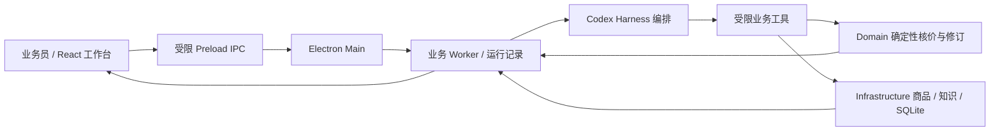

# TradeQuote

**把一封询盘，推进到一份有依据、可供人工核对的报价回复草稿。**

TradeQuote 是面向外贸询报价业务的桌面工作台。业务员提出目标，Agent 查询已发布商品资料、追问缺项、调用确定性业务工具核价、保存报价版本，并整理英语或德语客户回复。商品价格与金额来自业务服务；未知费用和未确认条款保持待确认。

项目处于 **M1 可运行原型阶段**，当前以 macOS 本机验证为准。正式人工审批、邮件外发、PDF 导出和签名安装包尚未完成验收。

## 当前能力

- **单据工作台**：在任务对话中查询商品、补充信息、核价、保存草稿和修订数量；可查看运行与工具记录。
- **资料与报价**：CSV 预览、人工确认发布、来源记录、价目表核价和历史报价读取。
- **版本与恢复**：新版本保留旧快照，展示数量与金额变化；应用重开恢复只读记录，重试由用户显式发起。
- **英语 / 德语客户产物**：固定文案切换、复制对应正文；未确认付款和交期显示对应语言的“待确认”。商品名、客户名和来源单位保留原文，不自动翻译或补造业务事实。
- **两个小人，各有职责**：任务对话小人展示业务运行状态；独立报价助手使用单独的人设与记忆存储，读取只读报价摘要，没有修改报价的业务工具。独立记忆不等于永久保存完整聊天。
- **启动体验**：独立奶油色品牌页和五彩纸屑，随后淡入工作台；系统开启减少动态时跳过动画。

跨品类、市场和目标语言由业务配置组织；英语 / 德语是当前首批产物实现，不是产品永久限定的范围。

## 知识关系图谱

侧栏“知识图谱”展示应用内的企业知识、固定来源、适用范围和报价引用，支持搜索、缩放、平移与详情。展开“企业资料录入、LLM 整理与人工审核”可导入项目 catalog_converted.csv 或本地 CSV，也可加入明确标注的合成演示资料。导入只生成待审核来源与候选；选择来源调用已配置模型整理后，需人工确认、检查、批准、发布。报价 Agent 当前消费已发布的付款/交期规则，金额仍由确定性核价计算。工程 Wiki 不作为产品企业知识数据。

## 快速开始

已验证环境：macOS arm64、Node.js **22.22.0**、pnpm **10.13.1**；Electron **44.9.2** 由锁文件管理。原生 SQLite 模块需要 Electron 对应的 ABI。任务工作台另需本机可执行的 Codex CLI（支持 `app-server`）；源码通过 PATH 查找 `codex`，也可用 `TRADEQUOTE_CODEX_BINARY` 指定绝对路径。Codex CLI 不由本仓库的 pnpm 安装步骤自动安装。

```sh
git clone https://github.com/jacson10l/tradequote-agent.git
cd tradequote-agent
corepack enable
corepack prepare pnpm@10.13.1 --activate
pnpm install --frozen-lockfile
pnpm dev
```

首次使用：

1. 在“工作区设置”创建本地工作区；填写“业务默认配置”（场景名称、岗位、平台、市场、品类与目标语言），点击“保存业务场景”。
2. 在“模型设置”保存自己的 DeepSeek 配置，选择账户可用的模型，并显式测试连接。API Key 不要放进源码、聊天或提交记录。
3. 在“资料与报价”导入 CSV、检查预览并人工确认发布。可先使用下方合成样本，格式见[报价 V1 说明](wiki-project/wiki/M2真实报价V1.md)。
4. 回到“单据工作台”，填写本次询盘客户并输入询价目标，补充缺项后保存未审核草稿，再修改数量并查看版本差异。
5. 查看检查结果，选择 English / Deutsch，复制回复草稿并人工核对。

可将以下明确合成的样本保存为 UTF-8 CSV，用于试用：

```csv
sku,name,category,unit,currency,min_quantity,unit_price,valid_until,description
DEMO-TEE,合成上衣,apparel,piece,USD,1,10.00,2027-12-31,仅为合成演示
DEMO-TEE,合成上衣,apparel,piece,USD,100,9.00,2027-12-31,仅为合成演示
```

模型请求会使用已保存的配置并可能产生供应商费用；应用不会回退到本机 Codex 连接。业务数据保存在本机，但模型运行会向配置的服务发送相关任务与上下文。没有模型配置时先完成设置。

遇到原生模块 ABI 不匹配时，执行 `pnpm native:rebuild` 后重试。

## 架构



模型理解任务并选择工具，Domain 负责确定性金额、版本和规则。金额以十进制字符串跨模块传递；Agent 不获得任意 Shell、文件或网络工具。独立报价助手走单独的对话与记忆通路，并复用保存的模型配置。

| 目录 | 职责 |
| --- | --- |
| `apps/desktop` | Electron 主进程、Preload、React 工作台与资源 |
| `packages/contracts` | 校验过的跨模块类型与 IPC 契约 |
| `packages/domain` | 确定性核价、报价修订、规则与产物 |
| `packages/infrastructure` | 受限 Agent 编排、SQLite、模型适配与事件持久化 |
| `tests/e2e` | 真实 Electron 桌面回归 |
| `wiki-project` | 工程 Wiki、任务、ADR 与验证证据 |
| `experiments` | 历史独立探针与合成演示，不等同正式产品 |

## 验证

```sh
pnpm typecheck
pnpm test
pnpm test:e2e
pnpm check
pnpm wiki:test
pnpm wiki:sync --base <本次改动前的提交>
```

2026-11-01 的功能版本 `00022ce` 已在集成分支完成本机复验：串行单元测试 **593 通过 / 3 跳过**、Electron **14 通过 / 1 跳过**、Wiki 工具 **36 通过**，类型、构建及工程检查通过。首轮并发单测有一项界面等待超时，未改代码、断言或超时，串行复跑通过；失败记录保留，根因未最终认定。上述数字是固定版本的历史证据，不代表每次新环境自动通过。

原生 ABI 下的串行复验命令：

```sh
ELECTRON_RUN_AS_NODE=1 ./apps/desktop/node_modules/.bin/electron node_modules/vitest/vitest.mjs run --maxWorkers=1
```

详见 [C11 集成与 Cue 回执](wiki-project/raw/c11-integration-cue-receipt.json)和[英德产物修复任务](wiki-project/wiki/tasks/C11-英德客户产物修复.md)。本轮自动化采用合成数据与模型替身；真实模型质量、人工语言与业务签认、Windows 和签名安装包不据此宣称通过。本项目当前使用本机检查，不运行 GitHub Actions。

## 演示与边界

[交互式流程演示](experiments/product-walkthrough/index.html)可下载后用浏览器打开，使用假数据说明业务流程；其中模拟的审批和输出不代表桌面已实现，见[演示说明](experiments/product-walkthrough/README.md)。新版 Cue 已完成八页产品演示，内容与记录见[C10 双语与演示核验](wiki-project/wiki/C10双语产物与新版演示核验.md)；私人分享密钥不保存在仓库。

- 当前产物是未审核草稿，不是已审批、已发送或具约束力的客户报价。
- 商品合计不包含未知的运费、税费及其他费用；未确认条款不自动转成已确认。
- 规则检查是有限的业务规则实现，不等于完整市场合规认证。
- 尚无人工基线计时对照，不宣称具体效率提升百分比。

## 参与开发

`main` 是公开默认入口，接收已验收的集成成果；`codex/m1-abc-integration` 保留为团队集成与人工验收基线。成员在独立 worktree / clone 的 `codex/` 任务分支开发，先合入集成分支并记录本机验证，再按发布安排同步 `main`。

代码、测试、配置与工程 Wiki 必须同次交付。先读[贡献规范](CONTRIBUTING.md)、[协作规则](AGENTS.md)和[项目说明书](wiki-project/wiki/项目说明书.md)。完整知识导航见 [Wiki 索引](wiki-project/index.md)，UI 变更遵循 [DESIGN.md](DESIGN.md)。

不要提交真实 API Key、客户原件、运行数据库、完整敏感日志或生成安装包。提交问题时使用脱敏或合成复现材料。

## 许可证

项目自有代码采用 [MIT License](LICENSE)。上游代码及依赖保留各自许可证，见 [THIRD_PARTY_NOTICES.md](THIRD_PARTY_NOTICES.md) 与 [UPSTREAM.md](UPSTREAM.md)。供应商图片、网页快照和其他引用资料的权利归原权利人，不因本仓库的 MIT 许可证而获得额外授权。
