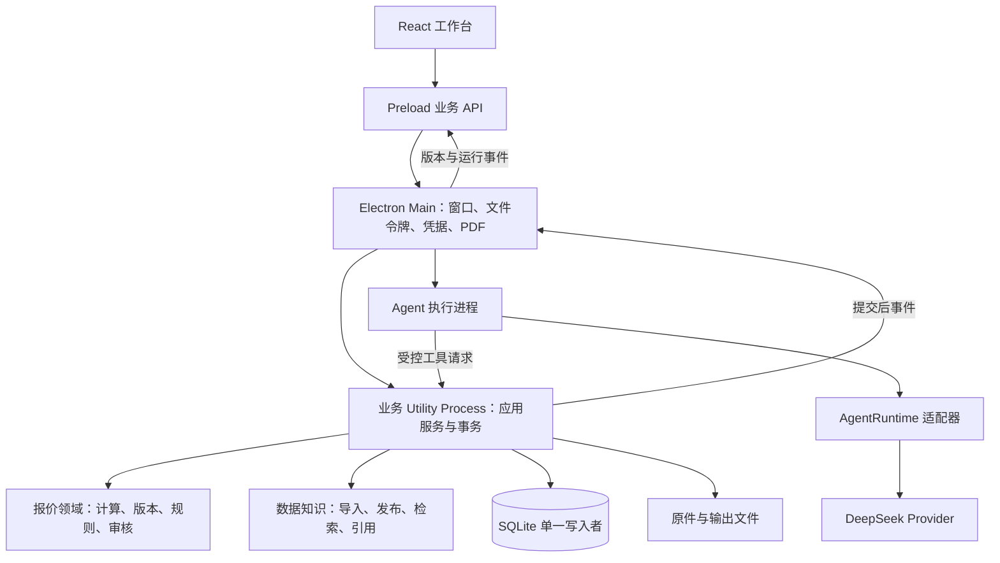

# 技术选型与架构

采用 TypeScript 模块化单体：Electron 承载桌面，React 展示单据，一个后台业务进程持有 SQLite 和应用服务，Agent 通过明确的业务工具调用服务。按模块组织代码，首版不拆微服务。

“确定”表示用户明确选择；“基线”表示本方案推荐且应在 M0/M1 验证；“候选”表示验证通过才进入主工程。文档检查不等于应用兼容性验证。

## 技术清单

| 层 | 选型与状态 | 采用理由与验证要求 |
|---|---|---|
| 桌面 | Electron，确定 | macOS/Windows；主进程管理窗口、文件选择、凭据、PDF、后台生命周期 |
| UI/语言 | React、TypeScript strict，确定 | 团队已有共同技术基础；领域层不引用 React/Electron |
| 开发构建 | electron-vite＋Vite，基线 | 分开构建 main/preload/renderer；后台入口需显式配置，[官方说明](https://electron-vite.org/guide/) |
| 安装包 | electron-builder 稳定版，基线 | 本地构建、CI 两个平台分别打包；原生模块逐平台验证，[稳定版文档](https://www.electron.build/v26/docs/features/multi-platform-build/) |
| 工程 | pnpm workspace，基线 | 支持契约与业务包；不先引入 Turborepo；版本在 M0 锁定 |
| UI 基础 | Tailwind CSS＋shadcn/ui＋Lucide，基线 | 按根 DESIGN.md 改语义 token；不接受组件默认主题覆盖 Mistral 方向 |
| 页面/异步 | React Router＋TanStack Query，基线 | 路由单选；Query 调用桌面 Client 接口而非直接访问 DB；小状态用 React |
| 表单/契约 | React Hook Form＋@hookform/resolvers＋Zod，基线 | 表单与边界 schema 对接；Zod 推导 TS 类型，模型工具 schema 的转换与支持子集需单独验证 |
| 持久化 | SQLite＋better-sqlite3＋Drizzle，基线 | 一个业务进程持有连接；开启 FK、事务、迁移；ABI 与打包测试为 M0 关卡。[Drizzle SQLite](https://orm.drizzle.team/docs/sqlite/get-started-sqlite) |
| 数量/金额 | decimal.js，基线 | 十进制字符串输入输出，显式舍入；禁用 JS number 计算金额。[API](https://mikemcl.github.io/decimal.js/) |
| XLSX | ExcelJS，基线 | 提取单元格及缓存值；不执行宏，不承诺计算任意 Excel 公式。[项目](https://github.com/exceljs/exceljs) |
| CSV | csv-parse，M0 选定解析器 | 7.0.3 对照实验通过；字段映射、数值 locale 和来源位置自建；见 [实测](技术验证记录.md)。[官方文档](https://csv.js.org/parse/) |
| PDF 输入 | pdfjs-dist，基线 | 文字与页码/位置提取；文字排序/表格结构用样本验证，扫描件不走成功路径。[PDF.js](https://mozilla.github.io/pdf.js/) |
| DOCX 输入 | Mammoth＋位置映射适配，基线 | 保留段落/表格序号，转义输出；旧 DOC 提示转换。[项目](https://github.com/mwilliamson/mammoth.js) |
| 业务知识 | 原件＋版本化 Markdown 内容＋SQLite 元数据，基线 | 发布与引用由业务库管理；检索副本可重建；先关键词/属性/术语检索 |
| 检索增强 | SQLite FTS5＋中文分词/术语展开，候选 | 中英文检索集不过关再引入 embedding 适配；不假定普通 FTS 已解决中文检索；不预装向量数据库 |
| 模型接入 | DeepSeek 优先，确定；HTTP/SDK ProviderAdapter，基线 | 配置能力矩阵；工具调用、JSON 输出、空响应、流式、取消需实测。[工具调用](https://api-docs.deepseek.com/guides/tool_calls/)、[JSON 输出](https://api-docs.deepseek.com/guides/json_mode/) |
| Agent 执行 | 最小执行器，当前采用；Harness 留作候选 | 0.2.1-rc.2 在 Electron 44.9.2 原生初始化失败，替代工具链＋SQLite 实测通过；见 [[M0平台验证记录]] |
| PDF 输出 | 结构化 HTML/CSS＋Electron printToPDF，基线 | 与界面使用同一事实快照；独立沙箱渲染窗口，禁用脚本和外部网络；字体与 RTL 实测。[Electron API](https://www.electronjs.org/docs/latest/api/web-contents#contentsprinttopdfoptions) |
| 测试 | Vitest＋React Testing Library＋Playwright Electron，基线 | 确定性逻辑、契约、真实 SQLite、桌面集成、人工模型评估分层；[Electron 自动化为实验支持](https://playwright.dev/docs/api/class-electron)，需验证目标版本 |
| 格式/质量 | Biome＋tsc，基线 | 一个格式体系；补充模块依赖边界检查，不同时再加完整 ESLint/Prettier 体系 |
| 日志 | Pino＋本地 AgentRun/ToolCall，基线 | 结构化、脱敏、关联 runId/revisionId；先不依赖远程监控平台 |
| 凭据 | Electron safeStorage，基线 | 主进程解密，受控传给执行进程；不可用时仅内存使用，不落明文。[API](https://www.electronjs.org/docs/latest/api/safe-storage) |

Node 构建环境优先评估 24.x 受维护版本，准确补丁号与 pnpm/Electron/原生库版本在 M0 锁入版本记录和锁文件。当前独立探针已验证 Node 22.22.0＋pnpm 10.13.1，见 [实验版本记录](../../experiments/m0-reuse/evidence/summary.json)，不把它当作最终桌面基线；构建 Node 与 Electron 内嵌 Node 分别记录。上游 Solivio 要求 Node ≥24.15.0、Yarn ≥4.14.1，不把其整个工具链自动带入本项目。

文档查询时 electron-builder 默认站点指向尚未发布的 v27，因此实施按实际选定稳定版文档核对配置；不复制 next 文档选项到 v26。不在本轮写一组未经安装验证的精确版本冒充锁定结果。

## 共享前端与契约：具体依赖及落地状态

2026-10-21 对照用户《项目构建技术栈》第 4.2 节复核：Tailwind CSS、shadcn/ui、Lucide、Zod 等原已列入上表，缺口是入口摘要和逐项实施状态；`@hookform/resolvers` 原未明确列出，本次补齐。下表细化既有基线，不代表新增依赖已经安装或正式产品已经实现。

| 职责与具体依赖 | 项目使用边界 | 当前证据与对应任务 |
|---|---|---|
| 边界校验：`zod` | contracts 定义 DTO/判别联合并推导类型；在 IPC、后台消息、模型工具参数等接收边界校验。金额计算、权限、审批和状态规则仍由领域/应用服务负责 | M0 manifest/锁文件为 **4.6.7**，`contracts.ts` 已有 DecimalString、Quantity、Patch、Revise、ApprovalBinding 子集及 4 项测试；T11 补完整契约与调用链，不能声称所有边界已接入 |
| 样式：`tailwindcss` | 统一使用根 DESIGN.md 的语义 token，样式入口由公共 UI 维护 | M0 未接入；T10 配置构建，T13 实现主题映射与代表页；精确版本和构建插件在正式安装时核对 |
| 组件：shadcn/ui | 公共按钮、输入、弹窗、表格等按需引入，适配 Mistral 浅色工作台；组件代码与所需依赖一并维护 | M0 未接入；T13 留下组件来源/配置及键盘、焦点、错误状态验证，不能以初始化命令成功代替验收 |
| 图标：`lucide-react` | 统一图标与可访问名称，状态仍配文字 | M0 未接入；T13 按页面实际需求引入 |
| 表单：`react-hook-form`、`@hookform/resolvers` | 编辑状态和字段错误对接 Zod；表单校验之外，服务接收边界仍需校验 | M0 未接入；T11 提供契约，T13 验证合法提交、无效输入和后端错误回显 |
| 路由：React Router | 沿用既有单一路由基线，处理工作台各业务页面 | M0 未接入；T10/T13 在正式 renderer 接入，不再并行增加 TanStack Router |
| 异步数据：`@tanstack/react-query` | 通过桌面 Client 调业务接口，管理查询、失效与加载/错误状态；数据库保持事实源 | M0 未接入；T13 验证命令提交后的刷新与版本冲突显示 |
| UI 状态：React 状态，Zustand 按需 | 选中行、面板开合、未提交表单与持久业务状态分开；复杂跨组件状态出现后再评估 Zustand | 当前无正式 React renderer；不预装 Zustand，不复制整个数据库到 UI store |
| 工程：React、TypeScript strict、Vite/electron-vite、pnpm | main/preload/renderer/worker 分开；构建 Node 与 Electron 内嵌 Node 分别记录 | M0 有 TypeScript strict、pnpm 和 React 依赖；React 用于 PDF 对照不等于已有 React 工作台；T10 才建立正式构建与 workspace |
| 质量：Biome、tsc、Vitest、React Testing Library、Playwright Electron | 单一格式体系；分别验证类型、领域/契约、组件行为、实际桌面进程 | M0 契约当前用 `tsx --test`＋Node test runner，已有 tsc；其余正式工程基线在 T14 接入并记录实际结果 |

当前设置窗口的源码是 `experiments/m0-platform/settings.html`、`settings.css`、`settings.js`，用于 M0 模型设置验证；没有采用 Tailwind/shadcn/React Hook Form。它不能作为正式 UI 技术栈的完成证据。探针中的 Zod 也尚未证明完整 IPC 或真实模型 schema 兼容性，见 [[M0契约评审准备]]。

原文件的按需清单仍按需求触发：分栏调整评估 react-resizable-panels，长列表评估 TanStack Virtual，Markdown 展示评估 react-markdown/remark-gfm，代码高亮评估 Shiki，命令面板评估 cmdk，提示评估 Sonner，界面国际化评估 i18next，图表在 Recharts/ECharts 中选择一个。多语言报价输出不自动要求界面国际化；本轮不将这些候选变为安装清单。完整后续验收落在 [[05-三人分工与开发步骤]]，本次复核记录见 [[2026-10-21-技术栈细节核对]]。

## 运行边界



Renderer 不持有数据库、模型密钥、任意文件路径或 shell 能力。Main 校验 IPC sender、schema、工作区与业务动作；业务服务仍做自己的校验。主进程和 Agent 不直接写业务数据库。

CPU 密集解析放可终止的 parser worker，结果交回业务进程提交。模型等待不占 SQLite 事务；Agent 可独立取消。长任务先保存 job/run，执行完成后短事务提交。数据库错误不能被翻译为“无商品”。

Agent 适配器可放独立 Utility Process；当前有条件选用 Harness，其 SDK 管理 runtime 子进程，由 C 继续验证 Electron 中的退出与打包。实测 SDK 无单会话取消接口，首版每个活动 run 独占 runtime，通过 close 取消，随后重建进程恢复；不能多活动 run 共享再承诺独立取消。无论采用何种执行器，都只通过同一组业务工具获取数据和提交草稿。

## 上游复用结论与技术关卡

规划时的源码检查见 [来源清单](../raw/source-manifest.md)。最新 [M0 技术验证记录](技术验证记录.md) 已覆盖两个 Solivio 原样候选与已发布 Harness 的真实本机运行；未运行完整 Solivio 应用，也未验证安装包或真实模型。

| 对象 | 本轮源码发现 | 实施方向 |
|---|---|---|
| Solivio 整体 | Next.js 模块化单体，PostgreSQL/pg-boss、运行时 accessor、构建时代码生成 | 本轮决定不整体 Fork，借鉴工作流；未声称全量运行对比 |
| CSV parser | 实测 BOM/引号基础样例兼容；分隔符误判、坏行处理、固定 ProductInput 与 locale 存在契约差异 | 不复制到生产；采用 csv-parse，自建映射与 decimal 解析 |
| offers | 实测纯 totals 浮点误差；服务仍耦合 Agent/运行时，模型与本项目快照不同 | 不复用金额 helper；Decimal 和自有领域/事务，UI 仅作参考 |
| offer-pdf | 基于 react-pdf；展示/路由依赖 next/dynamic、NextResponse | 评估模板元素与 payload；与 printToPDF 比较复杂文字、长表分页再选 |
| knowledge-base | 工具定义依赖 SDK runtime 与已有搜索服务 | 借鉴检索和来源交互；本地检索通过自己的 KnowledgePort |
| Harness | 同版本 SDK/runtime 0.2.1-rc.2 实际启动，工具链/取消/恢复实验通过；仍为 preview | 有条件复用发布包；补真实业务/模型/双平台打包；不 Fork 内核 |
| Harness sdk-minimal | 默认含 coding tools；本轮禁用并注册三个业务工具，每次模型请求的工具列表断言通过 | 维护可信自有 profile 与严格桥接，宿主提供身份/幂等上下文；禁用不等于分发包裁剪 |

G0 复用验收：A/B 各选一个纯逻辑或组件，列出直接/传递依赖、迁移改动、保留许可证、测试结果。可复用才落到模块内；无需为了“复用率”引入 Next/Postgres 服务栈。若整体 Fork 证实更有利，也必须满足离线业务数据、无需用户安装数据库服务、双平台安装和业务分层目标。

G1 Harness 验收：在打包后的客户端上完成 `search_catalog → calculate_quote → create_quote_revision`，只暴露授权工具，保存 run 与 revision 关联；取消后无孤儿进程、重试无重复版本。macOS/Windows 均需通过。任一核心边界无法满足则采用最小执行器，不影响 DeepSeek 模型优先路线。

G2 数据/解析/PDF 验收：安装包内数据库读写/升级、四种文件输入、字体/RTL/跨页表格与导出；字体从合法授权源打包，应用无需联网下载字体。

G3 模型验收：实际配置的 DeepSeek 模型必须通过工具 schema、结构化提取、跨品类理解、多语言与超时测试。模型名称从实际可用配置确定，不把上游 README 示例当作账户可用模型。

## 建议目录与依赖方向

以下目录在实施阶段创建；本轮没有这些业务包。

```text
apps/desktop/
  src/main/                 # C：系统能力与进程管理
  src/preload/              # C：窄接口
  src/renderer/
    features/catalog/      # A
    features/knowledge/    # A
    features/quotes/       # B
    features/review/       # B
    features/agent/        # C
    shared/                # C 维护框架；三人共用 token
  src/workers/             # C 生命周期，业务 owner 提供 handler
packages/
  contracts/               # B 主维护，全体审核
  domain/                  # B：纯报价计算、规则与版本语义
  application/             # 按 data、quotes、agent 子域分工
  data-knowledge/          # A：导入与知识用例
  agent-runtime/           # C：执行器/模型/业务工具适配
  infrastructure/          # A：SQLite、文件、检索适配；B/C 不直写表
tests/fixtures/            # 有来源或明确标记的合成样本
tests/e2e/
wiki-project/
```

`domain → contracts`；应用服务依赖领域与 ports；infrastructure 实现 ports；桌面 composition root 注入实现。禁止 domain 引用 electron、Next、数据库驱动或模型 SDK；禁止 renderer 引用 infrastructure；禁止 Agent 绕过应用服务执行 SQL。

不为了目录完整一次创建所有空包。M1 先落地 contracts/domain/desktop 与最小存储，M2/M3 随纵向功能增加模块。

## 配置、任务和存储

- SQLite、原件、PDF、企业知识版本存放在 `app.getPath('userData')/workspaces/<workspaceId>/`；原件按 SHA-256 管理，数据库记录相对键，不把个人绝对路径写入契约。
- 一个活动工作区一个业务进程；互斥锁避免两个应用进程同时写同一工作区。
- 任务队列先用 SQLite job 表和单写入 worker；持久化状态、重试次数、下一次执行时间；不依赖 Redis/pg-boss。
- 配置分为模型、商品 schema、单位转换、价目表/成本策略、规则集、术语/语言模板、导出模板，各有版本；更改默认配置不回写历史报价。
- 后台备份使用 SQLite 一致性备份机制和原件 manifest；不在写入中只复制 `.db` 忽略 WAL。恢复到新工作区，校验 schema 与文件哈希，再切换。
- 首版只实现一个本地经营主体的工作区；工作区 ID 是数据命名空间，不宣称已支持多租户安全。

关联：[数据契约](03-领域与数据契约.md)、[接口契约](04-接口与Agent契约.md)、[服务器演进](07-服务器演进与风险.md)。

工程知识关联：[[系统架构]]、[[0002-上游复用方式]]。

## 本轮选型更新

当前精确运行组合、失败与替代见 [[0004-M0平台与执行器选型]]，覆盖上文早期 Harness 有条件采用结论。用户暂缓最终平台安装验收，允许继续开发；未运行关卡保留，不宣称全平台冻结。模型设置已有最小验证窗口，见 [[模型服务设置验证]]。
