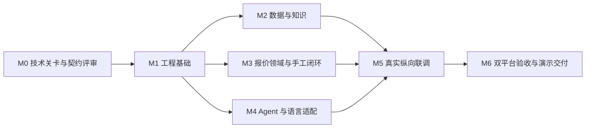

# 三人分工与开发步骤

按验收里程碑推进，不承诺固定天数。任务 ID 可直接用于 Issue/PR 标题，领取时填写实际负责人名字和证据链接。当前正式工程已有 M1 工作区与手工报价 V1，正式模型与受限修订已接入、真实供应商评估与审批尚未完成；M0 历史证据见 [M0 技术验证记录](技术验证记录.md)，当前状态见 [[项目状态]]。赛事解释以 [[参赛要求对齐与验收]] 为准，执行顺序见本页“下一轮开发优先级”。

## 本批可领取任务

当前实际开工以 [[三人并行开发交接]] 为入口：A01知识发布/来源查询，B先B00契约再B01规则/双反馈，C01运行恢复/集成。任务边界与接口见 [[首批并行接口约定]]；三张任务页明确文件、依赖和验收：[[A01-知识发布与来源查询]]、[[B01-规则检查与双反馈]]、[[C01-Agent运行恢复与集成]]。

成员必须分别建任务分支并使用独立clone/worktree。公共起点/PR目标为codex/m1-foundation，不能在main或集成分支直接开发。B00先合，A样本与C独立验证可先行；A知识迁移4、C运行迁移5、B检查表之后编号由A登记。总体路线仍保留，但不能把后续大任务一次性全部分给成员；按本批可验证切片逐次合入。实际成员签字/各机启动仍待执行。

## 所有权与共同规则

| 开发者 | 负责的前后端闭环 | 公共职责 | 默认评审者 |
|---|---|---|---|
| A | 导入、映射、商品/价格、原件、知识发布、检索与来源 | 数据库迁移序列、存储实现、备份格式 | B |
| B | 询盘/报价、两种定价、规则、版本、任务、审批与 PDF 内容 | 公共 contracts、计算口径、状态转换 | C；计算/存储再由 A 复核 |
| C | Electron 外壳、公共 UI、Agent 对话、DeepSeek、工具编排、运行恢复 | 构建/CI、进程生命周期、版本锁定、最终集成 | A |

A/B 自行完成各自 feature 页面；C 仅维护应用框架与公共组件，不能把所有 UI 都排到 C。PDF 的业务内容/快照/模板由 B 负责，Electron 渲染与系统导出 adapter 由 C 负责。知识发布通道由 A 负责，规则语义 B 负责，语言模板生成 C 负责。

公共契约变更流程：提出字段和失败样例 → B 修改 schema 与 mock → A/C 审核调用及持久化影响 → 合并契约 → 实现方与调用方跟进。禁止一方临时改 DTO、另一方用 `any` 消除报错。

首版三个全栈成员不等于已经有外贸业务专家。工程团队可使用标明合成的数据验收系统；真实产品属性、商业条款及市场规则由资料提供人/业务验证者确认，安排在 M2 资料准备任务，不虚构事实。

## 依赖图

M3/M4 前期可用契约 mock 并行，mock 不能作为 M5/M6 验收证据。优先串通“导入一个商品→人工建立报价→真实模型修改→保存新版本→导出”这条最短链路，再补齐更多页面和异常。

图表示并行工作线；跨线的具体任务依赖以表格为准。例如 T32 要等 T23，T43 要等 T34，不能把整条工作线都当成完全独立。

## M0 技术关卡与契约评审

M0 使用独立的最小验证工程或临时验证分支，先验证运行时、原生依赖和一个业务工具；不依赖尚未创建的完整产品。可保留可复用的探针与记录，M1 再根据结果正式初始化主工程。这样“双平台打包探针”不会循环依赖 M1 的工程骨架。

| 任务 | Owner | 依赖 | 具体产物与完成标准 |
|---|---|---|---|
| T00 契约评审 | B，全体参与 | 无 | 将 03/04 两页转为字段清单、事件与错误清单；确认 snapshot/approval/幂等语义；记录评审结论 |
| T01 Solivio 复用评估 | A＋B | 无 | 从固定 commit 各抽取一个候选，做依赖图和样例验证；明确复用文件/改写/放弃及理由；保留许可 |
| T02 Harness 与 DeepSeek 验证 | C | T00 | 固定 runtime/client；真实业务工具 allowlist；真实模型调用、结构化结果、取消/恢复；两平台打包验证；失败采用最小执行器 |
| T03 存储和解析验证 | A | T00 | 原生 SQLite 安装包读写；XLSX/CSV/PDF/DOCX 样本提取与来源位置；识别 XLS/DOC/扫描输入的处理边界 |
| T04 PDF、平台与版本组合 | B＋C | T00 | printToPDF 对照可复用 PDF 模块；长表、中文/德文/RTL、字体打包；记录实际 OS/CPU；固定稳定依赖组合 |

退出门槛：G0～G3 各有“通过/采用替代/未通过”与证据；原方案要求必需平台关卡全部通过再进入正式业务开发；用户本轮明确调整为先不考虑最终安装/双平台验收，允许继续推进可独立开发内容，发布前补齐。无 API Key 或无 Windows 环境时如实保留该关卡待验证，可推进契约与纯逻辑，但不宣称已冻结运行方案。

已生成：[技术验证记录](技术验证记录.md)、[UPSTREAM](../../UPSTREAM.md)、[第三方许可](../../THIRD_PARTY_NOTICES.md)、[实验版本与命令](../../experiments/m0-reuse/evidence/summary.json)。T01 两个原样候选的刻画和选型完成；T02 已完成受控工具、进程取消及恢复的本机实验。T00 三人评审仍未完成，探针使用合成 DTO，不冒充契约冻结。真实模型/双平台打包/真实存储仍待验证，M0 不关闭。

## M1 工程基础

| 任务 | Owner | 依赖 | 具体产物与完成标准 |
|---|---|---|---|
| T10 桌面与 workspace | C | T00、T02、T03、T04 | main/preload/renderer/worker；electron-vite、React strict TS、Tailwind 构建入口、React Router；固定 Node/pnpm、锁文件；安全窗口与 narrow IPC；干净检出可启动 |
| T11 契约与领域骨架 | B | T00、T10 | Zod DTO、typedPatch、ports、错误、mock；renderer/Agent 调用同一服务定义；IPC/后台/模型参数边界校验及拒绝测试，工具 schema 转换独立验证 |
| T12 初始迁移与文件仓库 | A | T10、T11 | workspace/source/job/幂等/outbox 基础；SQLite 单写入、ArtifactStore；迁移与回读测试 |
| T13 代表性工作台 | C 框架，A/B feature | T10、T11 | DESIGN.md token→Tailwind/shadcn/ui、Lucide；React Hook Form＋@hookform/resolvers＋Zod 表单；TanStack Query→桌面 Client；单据表格、对话、风险与差异；空/错/禁用/焦点、提交刷新与冲突状态实测 |
| T14 CI 与 Wiki 维护 | C，A/B 配合 | T10、T11 | Biome/tsc/Vitest/React Testing Library/Playwright Electron 与 build；模块边界；将已有 Wiki 生成/check/lint 纳入 CI，随新增源码更新映射 |

退出门槛：两个系统能安装并启动最小应用，创建/重开一个本地工作区；关键 IPC 契约测试通过；本机无需安装独立 PostgreSQL 服务。

## M2 数据与知识

| 任务 | Owner | 依赖 | 具体产物与完成标准 |
|---|---|---|---|
| T19 演示场景与证据范围 | B 主持，A/C 参与 | 无；配置字段随 T00/T11 评审 | 明确用户/平台/市场/品类、英德目标语言、两工作流、输入与来源状态；选择可验证样本，不以合成规则宣称真实合规 |
| T20 样本与字段 schema | A，B 复核 | T11、T19 | 三类差异化商品、四种文件、询盘、价格/成本、规则/术语；合成/来源状态明确 |
| T21 导入闭环 | A | T12、T20 | 文件选择→staging→映射预览→人工确认→版本入库；逐行错误、重复确认与冲突处理 |
| T22 商品/价目表与检索 | A | T21 | 属性/单位配置、档位与有效期；候选差异；检索返回稳定 revision 与 evidence |
| T23 企业知识与引用 | A，B 定义规则 schema | T21 | 文档抽取草稿、人工发布、过滤适用性、版本化 Markdown、来源定位与术语检索 |
| T24 平台与本地化配置 | A 发布/来源，B 规则，C 模板 | T19、T23、T11 | 选定平台规则与风格分层、locale/商务语气/格式/术语配置版本；人工确认来源与适用性，英德及 RFQ/邮件正反样本；失效/缺证据保持待核实 |

退出门槛：AC-01/02/03/06；资料提供人可核对每项关键事实来源，未确认知识不参与正式报价。

## M3 报价领域与人工操作闭环

| 任务 | Owner | 依赖 | 具体产物与完成标准 |
|---|---|---|---|
| T30 确定性定价 | B | T11、T20 | 两种策略、单位/汇率、折扣/费用分摊、舍入、trace；所有金额边界测试通过 |
| T31 单据与不可变版本 | B，A 事务适配 | T12、T30 | create/revise/compare/restore；expectedVersion＋幂等；重启保留旧版本 |
| T32 规则与内部任务 | B | T23、T24、T31 | 合同/目标市场两类及平台产出检查；稳定 checkId/category 与字段/内容块定位；风险标记＋文本批注共享结果；block/pending 区分、任务去重、修改后重检并保留历史 |
| T33 审批与产出绑定 | B | T31、T32 | revision/contentHash/bundleHash 校验；新版本/新语言产出不能借旧审批 |
| T34 PDF 和正式导出 | B，C adapter | T04、T33 | 中文内部摘要、目标语言正文/报价；草稿标记；正式版只导出已批 bundle |

退出门槛：不用模型也能通过界面完成手工报价→修改→审核→PDF；AC-05/07/08/09/11 的确定性部分通过。Agent 接入不能成为业务计算开发的前置阻塞。

## M4 Agent 与语言适配

| 任务 | Owner | 依赖 | 具体产物与完成标准 |
|---|---|---|---|
| T40 Provider 与凭据设置 | C | T02、T10、T11 | DeepSeek 连接测试、能力矩阵、密钥加密保存、超时/限流/空输出处理 |
| T41 询盘与工具编排 | C | T11、T40 | 单会话、工具 allowlist、结构化提取、检索与 typedPatch；mock 开发后切真实服务 |
| T42 对话与版本事件 | C，B review UI | T31、T41 | 提交后刷新单据、差异定位、版本冲突提示；不依赖聊天文本推测保存成功 |
| T43 任意语言与平台文化适配 | C 生成，B 模板，A 来源 | T24、T34、T40 | profile/locale/术语版本、factRef、RFQ/邮件结构差异、英德语气及本地格式；output.validate 与人工语义复核、新 bundle 审批；通用回退明确限制，另做 CJK/RTL 排版验证 |
| T44 运行恢复 | C，A 持久化 | T12、T41 | run/tool/job 记录，取消/重启/重连、受控重试、同幂等键恢复 |

退出门槛：一次真实模型调用产生新 revision，手工与 Agent 使用同一计算/规则服务；语义错误可见而非静默成功。

## M5 纵向联调与异常

| 任务 | Owner | 依赖 | 具体产物与完成标准 |
|---|---|---|---|
| T50 主流程集成 | C 主持，全体 | T22、T23、T34、T42、T43 | 三品类资料→V1→两轮变更→审核→PDF；来源、金额和当前版本一致 |
| T51 并发与失败注入 | B＋C | T44、T50 | 人工编辑与 Agent 冲突、重复提交、数据库失败、PDF失败、取消提交边界；无丢失/重复 |
| T52 备份与演示工作区 | A，C UI | T12、T50 | 一致性备份、导入新工作区、迁移失败恢复、演示重置；凭据不入包 |
| T53 评估集与业务复核 | B 主持，全体 | T50、T51 | 开发/保留样本分离；事实/平台/文化/格式人工评分，检查双反馈定位与一致性；主演示各维度 2 分；保留失败与修订证据 |

退出门槛：所有 P0 都能在真实服务下验收，阻断性缺陷清零；检索、调用、风险和审批均有证据。

## M6 双平台验收与交付

| 任务 | Owner | 依赖 | 具体产物与完成标准 |
|---|---|---|---|
| T60 macOS 安装验收 | C 操作，B 见证 | T51、T52、T53 | 明确 OS/CPU/安装包 hash，干净安装、完整主流程、重启/升级/备份恢复 |
| T61 Windows 安装验收 | A 操作，C 协助 | T51、T52、T53 | 与 T60 同样标准；中文路径、权限、字体、原生模块无异常 |
| T62 文档与交付包 | 全体 | T60、T61 | README 实际命令、迁移/锁文件、示例配置、许可、模型/工具版本、验收记录、已知限制 |
| T63 比赛演示准备 | B 主持，全体 | T50、T51、T52、T53 | 按 C-01～C-06：两工作流、初稿后两轮对话、英德产出、平台/文化适配、两类校验与风险标记＋文本批注；重置后 5 次稳定演练，备用录屏标明回放；最终交付仍须 T60/T61/T62 |

退出门槛：见 [测试与交付](06-测试与交付.md)。T63 可在本机业务联调后先演练，不因双平台安装暂缓而延后发现业务缺口；不据此关闭 M6 或降低双平台交付门槛。海报、路演时长和具体提交格式按取得的完整赛事规则另外完成；不让材料准备替代应用验收。

## 每次集成与 PR

**P0 前置条件：代码作者必须在同一交付中同步相关知识页、任务页与追加日志。Wiki 未同步或检查失败，任务不得标完成、PR 不得合并。A/B/C 各自负责，不由 C 统一事后补写；评审者必须核对实现与文档。** 执行命令及门禁见 [[Wiki 工作流与任务记录]]，实施见 [[2026-10-21-Wiki强制同步规则]]。

1. 使用短分支和小 PR；AI 生成分支默认 `codex/<task-id>-<topic>`。一个 PR 明确问题、行为和验证。
2. migration 变更先与 A 排序；公共契约变更先合入或以同一 PR 同步所有调用者。
3. PR 至少一个非作者评审；金额/状态/迁移变更需对应 owner 复核。CI 通过后再合并。
4. 每个可演示纵向切片完成后集成，不等三条大分支都“完成”才第一次合并。
5. 每个合入任务同步实际状态、来源和验证命令；不能把待验证模型输出写成测试通过。

M1 要实现的脚本契约：

| 命令 | 期望行为 |
|---|---|
| `pnpm dev` | 启动开发版 Electron 与后台 |
| `pnpm check` | Biome、模块边界、文档检查 |
| `pnpm typecheck` | 全部生产与测试代码类型检查 |
| `pnpm test` | 确定性单元/服务/真实存储契约测试 |
| `pnpm test:e2e` | Electron 核心流程 |
| `pnpm eval:agent` | 显式启用真实模型评估；缺凭据报未运行，不假通过 |
| `pnpm build` | 编译各进程 |
| `pnpm package:mac` / `pnpm package:win` | 对应平台生成安装包，默认不发布 |
| `pnpm wiki:check` | 源码索引漂移、引用、任务与决策一致性 |

上述根 package 脚本除 eval:agent 外已随 M1 初始化建立；eval:agent 的供应商评估用例仍待补，正式应用连接入口已经接入，当前没有假成功入口。实际执行范围见 [[M1验证与协作]]，Wiki 门禁见 [[Wiki 工作流与任务记录]]。将来服务器分工见 [演进方案](07-服务器演进与风险.md)。

工程知识关联：[[2026-10-21-M0技术验证]]、[[Wiki 工作流与任务记录]]。

## 当前增量与推进顺序

T00 材料与部分 executable schema 已准备，三人评审仍待完成；T02 Electron 中 Harness 失败、最小执行器合成工具链通过；T03/T04 已实际执行本机探针。以 [[M0平台验证记录]] 为当前结果。用户暂缓最终安装验收，不再以此阻塞后续 M1 基础实现；真实模型通过系统设置后验证，仍不标 G3 通过。

## M1 当前实施进展

2026-10-21 已建立正式 workspace 与工作区纵向切片，见 [[2026-10-21-M1工程初始化]]。T10 已有四进程入口/安全边界/构建；T11 已有工作区 DTO、ports、两个 patch schema 和拒绝测试，完整报价契约待三人评审后扩展；T12 初始五表迁移/工作区事务/ArtifactStore 已实现，任务消费与恢复待后续；T13 实际工作区表单与代表性合成工作台可用；T14 本地质量入口及 CI 配置已接入，远端执行未验证。最终双平台安装按用户决定暂缓，M1 整体仍 active。三人分别接手自身模块并同步知识页，不能只交代码。

## M1 后续增量

初始化已保存为本地 7c5a2eb；[[2026-10-21-M1布局图标与契约补齐]] 继续推进 T11 的九类 patch/Fact/来源/审批绑定/事件基础、T13 窗口滚动与缩放、T10/T14 产品图标与构建漂移检查。T12 已有初始表、文件仓库、迁移回读与原子性测试；job/outbox 实际消费/运行恢复随 T21/T44 实现，不作为已完成服务。T00 必须由实际成员评审；不以 Agent 自检代签。M1 整体仍 active，最终双平台安装门槛仍待验收。

## 下一轮开发优先级（2026-10-21 对齐后）

优先级按可验证的纵向成果排序，任务 ID 和 A/B/C 所有权保留；下列阶段完成不自动将涉及的大任务全标 done。各小切片须在任务页记录已做/剩余 AC，遵守代码与 Wiki 同一交付。当前第 1/2 顺位的场景、CSV/价目表/手工 V1 子集已落地，T00 人工评审、资料适用性与 T40 真实连接未完成，不能整阶段标 done；当前第三顺位代码与HTTP替身两轮测试已接通，下一步补真实供应商评估和取消/恢复，不以页面数量或纯 schema 数量代替业务进展。

| 顺位 | 任务与依赖 | 三人交付重点 | 可进入下一阶段的证据 |
|---|---|---|---|
| 1 范围与契约 | T19＋T00/T11 增量评审；补 T12 必需迁移 | B 明确演示配置、报价/检查/输出契约；A 确认来源和迁移顺序；C 确认模型/工具/事件接口 | 一份具体场景卡、字段/错误/正反样本与实际成员评审；配置不能默认为已批准 |
| 2 真实 V1 | T20→T21→T22/T23；T30→T31；C 同时推进 T40 | A 先接一种导入格式与一组样本的确认/发布/检索；B 先完成一种定价的确定性计算和手工 V1；C 把设置与真实连接移入正式工程 | 资料→已发布来源→手工报价 V1→重启回读；真实模型连接结果单独记录；其余格式/定价仍待做 |
| 3 两轮业务修改 | T41/T42，依赖 T31/T40 与真实检索；T44 最小持久化/取消 | C 接真实模型和 allowlist；B/A 保证事务版本、差异与幂等 | 询盘经真实工具产生 V1；两轮对话保存 V2/V3，重算一致、旧版不变；超时/取消不丢已提交版本 |
| 4 适配、检查与审批 | T24→T32→T33/T34→T43，依赖发布知识与模型 | A 发布可核验规则/术语；B 两类检查、双反馈与审批/PDF；C 双语、平台/文化模板和产出检查 | 两类问题各有风险标记＋文本批注，英德/RFQ/邮件经复核；审核绑定准确，产出可导出；完成两条业务工作流 |
| 5 稳定性与演示 | 补齐 T20～T44 未完成 AC，再 T50/T51/T52/T53→T63 | 三品类/四格式/第二定价、失败恢复、语义评分、隔离重置与两工作流联调 | AC-01～13、AC-15/17 与 C-01～06 对照有证据；AC-16 的最终交付证据随 T62 补齐；主演示重置后连续 5 次，本机与安装验收分开 |
| 6 完整交付 | T60/T61→T62；T63 补最终平台证据 | 按原项目要求完成 macOS/Windows 安装、升级/恢复与交付材料 | AC-14、完整 M6/MVP 门槛通过；暂缓期间保持未完成，不用本机演练替代 |

T24 的来源调查和 T53 的样例设计应从第 1 顺位开始，避免到生成阶段才发现缺资料；表中是集成退出顺序，不要求成员空等。T40 可先独立验证真实连接，直到真实业务工具、数据与版本链路接通才算 C-02/C-03 通过。

后置范围：批量询盘/批量生成、第二电商平台接入、自动外发、服务器共享、多自主 Agent、额外装饰性 UI。它们不是截图硬要求；不影响产品既有跨品类/任意语言配置能力，也不能挤占可靠性与人工审批工作。决定见 [[0007-参赛要求与交付优先级对齐]]，本次文档任务见 [[2026-10-21-参赛方案与验收对齐]]。

## 手工 V1 实现对照

[[M2真实报价V1]] 已落地可编辑场景、CSV 暂存/人工发布、价目表档位与草稿冻结/重开，任务见 [[2026-10-21-演示场景与报价V1]]。这不是完整 AC-01/03/05/06/08/11/12 或赛事工作流验收：导入仅固定 CSV，知识检索、价格更新、第二定价、平台文化校验、双反馈、正式审批/PDF仍待完成；后续 [[M4模型与报价修订]] 已新增正式Provider与V2/V3路径，真实供应商验收未执行。执行接口以 contracts/trade.ts 与 agent.ts 的已实现子集为准，本文其余规则保持目标/待评审设计；T00 人工评审未代签。

## 本轮后的实际开发顺位

1. T40/T41/T42：正式设置、HTTP adapter、V1/V2/V3已实现；先在应用配置真实Key跑同样两轮，核对提取/修改语义与失败提示，补能力矩阵，不将HTTP替身结果算真实模型通过。
2. T44最小取消/中断/待决操作恢复：当前成功版本可重开、相同操作键可回放，但页面重启前未保存请求不恢复。
3. T24/T32/T43：平台文化profile和规则来源、两类检查＋风险标记/文本批注、英德业务产出与人工语义复核；差异表不替代规则反馈。
4. T33/T34/T50：人工审批绑定具体revision/bundle，PDF和完整两工作流；补知识检索、资料/价格更新和第二定价等缺口。
5. T63稳定五次演练、T60/T61/T62双平台/恢复/交付，最终安装按此前用户决定暂缓。

证据与限制见 [[M4模型与报价修订]]、[[2026-10-21-正式模型与两轮修订]]。不按页面数估算完成百分比，T00人工评审/真实资料适用性继续作为待办。

B00协议代码已在独立分支交付审阅，新增门禁不开放业务IPC；精确实现与评审状态见 [[B00-首批公共契约]]。B01仍未实施，A/C先评审后合入共同基线再接新类型。

## A01升级后的实际优先级

用户本轮要求完整业务LLM Wiki目标；旧A01仅规则发布的切片范围被 [[A01-知识发布与来源查询]] 的五阶段取代，T23版本化Markdown原目标保持。

1. B00先按原范围评审；B00a P0补正文/多来源/审核/检索引用与异步端口。A同时准备合成原件与Markdown样例、存储设计；C继续独立报价运行恢复。
2. A01a原件/Markdown版本→A01b人工审核发布→A01c检索引用，B01按新已发布规则查询接口接入，避免旧规则协议成为第二套库。
3. B00a P1知识运行/维护协议→C知识整理执行适配与A01d候选增量整理；A只负责业务校验/保存，C负责Provider、取消重试和受控接线。
4. A01e lint/来源更新影响/复核/索引重建，B将影响列表接到报价复核，完成两轮来源更新与历史回读演示。

每个子切片独立验收；完整A01必须满足A-W01～10。真实模型未评估时不标完整AI链路通过；实际A/B/C评审与字段签字不能由本次文档代替。方案 [[A业务LLMWiki方案]]，契约任务 [[B00a-业务Wiki契约补充]]。
