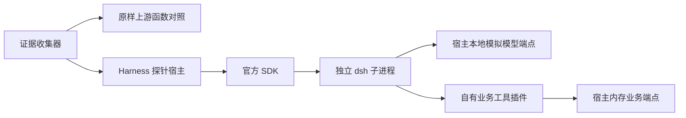

# 系统架构

> 2026-10-21 本轮增量见 [[M0平台验证记录]] 与 [[0004-M0平台与执行器选型]]：新增真实 Electron/SQLite/解析/PDF/设置页探针；Harness 在当前 Electron 版本失败，默认切最小执行器。下文原 M0-reuse 结果保留其历史作用域。安装/双平台验收按用户决定暂缓。

当前正式系统见 [[M1工程基线]]：React → preload → Main → 业务 Utility Process → SQLite。工作区创建/修改/重开已实测，报价和 Agent 未接入。

## 历史 M0-reuse 架构

早期可运行系统是独立 M0 探针。入口 `experiments/m0-reuse/collect-evidence.mjs:17` 顺序执行 Solivio 行为刻画与 Harness 探针，汇总退出码。当时尚未创建正式桌面与领域模块；该句仅描述早期探针，不表示当前工程状态。

插件传业务参数，宿主拥有计算、幂等与草稿状态。runtime 负责对话、工具调度及会话日志。这里的 HTTP 是环回测试接口，不代表项目已经实现服务器共享。

输入为固定合成询盘与三工具脚本；输出为证据 JSON/TAP 和 `.runtime/` 临时会话。`pnpm-lock.yaml` 记录完整依赖解析，约九千行，已核对 importer、版本覆盖与边界，没有逐个审计传递依赖实现。

历史 Node 22.22.0/pnpm 10.13.1 为实验环境；M0 后续已实测 Electron 44.9.2，正式 M1 版本见工程基线。未来边界以 [[02-技术选型与架构]] 为设计依据，不能把规划目录画成已运行模块。实际工具能力见 [[运行时能力地图]]，当前交付状态见 [[项目状态]]。

## M1 运行更新

现有 apps/desktop 已建立 Electron main/preload/renderer/业务 Utility Process，contracts/domain/infrastructure 四模块实际可用。正式工作区创建/重命名/重开走真实 SQLite；M0 experiments 保留独立。运行与构建边界见 [[M1工程基线]]，不再以“只有探针”描述当前工程。

## 工程Wiki与业务Wiki边界

工程wiki-project维护源码知识，随代码评审；拟建业务Wiki属于workspace运行数据，不复用工程索引或指令。业务原件/版本化Markdown用不可变artifact，SQLite管理发布/审核/来源/消费引用，可重建Markdown视图与关键词索引供导航。AI整理只产生候选，人工批准后显式发布；语义推断不可冒充原始事实。该链路是待实现设计，当前B00仅协议基础，见 [[A业务LLMWiki方案]]、[[0011-业务LLMWiki与工程知识隔离]]。
