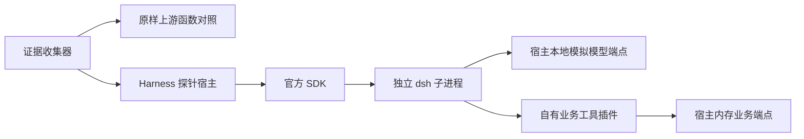

# 系统架构

当前可运行系统是独立 M0 探针。入口 `experiments/m0-reuse/collect-evidence.mjs:17` 顺序执行 Solivio 行为刻画与 Harness 探针，汇总退出码。不存在 Electron main/preload/renderer、生产领域包、数据库、CI 或安装包。

插件传业务参数，宿主拥有计算、幂等与草稿状态。runtime 负责对话、工具调度及会话日志。这里的 HTTP 是环回测试接口，不代表项目已经实现服务器共享。

输入为固定合成询盘与三工具脚本；输出为证据 JSON/TAP 和 `.runtime/` 临时会话。`pnpm-lock.yaml` 记录完整依赖解析，约九千行，已核对 importer、版本覆盖与边界，没有逐个审计传递依赖实现。

当前 Node 22.22.0/pnpm 10.13.1 是实测实验环境；Electron 目标版本与内嵌 Node 待 M0 打包关卡确定。未来边界以 [[02-技术选型与架构]] 为设计依据，不能把规划目录画成已运行模块。实际工具能力见 [[运行时能力地图]]，当前交付状态见 [[项目状态]]。
