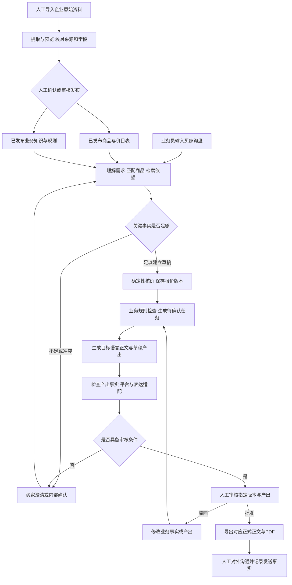
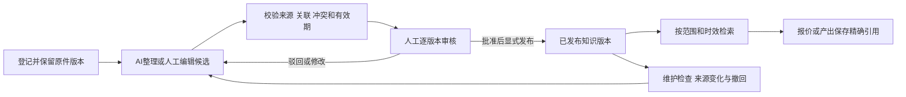
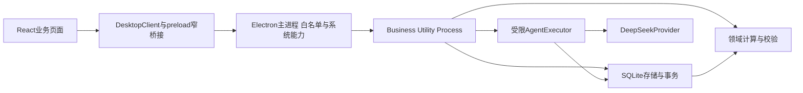

# TradeQuote 项目说明书

**TradeQuote 要做成一款供中小出口企业使用的询报价协同桌面应用：业务员导入企业资料、录入买家询盘，系统辅助理解需求、查找依据、计算报价、处理变更、组织复核，并在人工审核后输出面向买家的报价内容。**

开发团队应围绕一张持续流转的报价单组织产品。AI 负责理解和表达，确定性业务模块负责金额与状态，企业资料负责事实依据，人工负责资料发布与最终商业承诺。用户最终拿到的应是可以核对来源、比较版本、完成审核并导出的业务结果。

当前已有可运行的 Electron 桌面工作台，以及“CSV 发布→手工草稿 V1”和“模型理解→受限 V2/V3 修订”两个实际切片。完整业务知识库、规则检查、内部任务、审批、多语言产出、正式 PDF 和持久化运行恢复尚未完成。本文以 **2026-10-21、共同分支 `codex/m1-foundation` 的 `e0f933657c2438642b006fd1a5549fe7dc683ccd`** 为核对基线。

本轮规格补充保留原14章结构：第5.5节规定询盘理解，第7.4节规定包装与场景继承，第8.3节规定依据链，第9.4节规定语言及平台适配，第13.4节给出逐项验收和HTML覆盖边界。这些是正式产品的目标规格；不将HTML离线规则等同于正式服务。公共接口仍由B在contracts统一定义，下文数据项是语义要求，不是已经发布的新DTO。

## 阅读导航

配套[可操作HTML演示](../../experiments/product-walkthrough/index.html)将本说明书的目标流程变为假数据交互，可从V1修订、处理缺项到人工审核和本地导出；每页的开发说明标出正式实现边界。使用与验证见 [[产品交互演示]]。样机现补充原文识别/澄清、字段与知识依据链、默认包装待确认和修订场景继承；语言仍为离线模板，其他语言请求明确未支持，不表示正式功能接通。

- 第 1～3 节：最终产品、使用者、产品边界。
- 第 4～6 节：主要功能、完整业务流程、贯穿案例。
- 第 7～9 节：业务对象、版本状态、业务知识库与 AI 的职责。
- 第 10～11 节：当前真实实现、页面与源码入口。
- 第 12～14 节：开发分工、完成标准、新成员上手及来源索引。

文中的“目标”表示已约定的产品方向；“已接通”表示当前源码存在实际执行链路；“契约/方案”表示类型或设计已准备、服务未交付；“历史验证”只对相应证据的提交与环境有效。章节编号 M2/M4 表示工作线，不能据此认定此前所有里程碑已经完成。

## 1 最终产品是什么

### 1.1 业务场景

典型用户是一家拥有商品目录、销售价目表和内部业务资料的中小出口企业。业务员通过 RFQ（买家询价请求）或邮件收到需求，需要在商品、价格、采购确认、商务条款和目标语言之间反复核对。

例如，买家询问一批商品的价格和交期。业务员先确定商品及规格，再按数量选择价格档位，核实包装、交货条件和付款要求，组织英文或其他语言回复。买家修改数量后，单价档位、总额、交期、文本和审核结论可能都需要重新核对。TradeQuote 把这条链路组织为有来源、有版本、有待办、有人工审核的单据流程。

### 1.2 用户最后应该得到什么

| 面向谁 | 产品目标产物 | 主要用途 |
|---|---|---|
| 业务员 | 结构化询盘、报价草稿、待澄清问题、来源与计算依据 | 判断这份报价是否完整、哪些条件还不能承诺 |
| 采购或内部确认岗位 | 中文确认任务、所需字段、证据与变更原因 | 补齐成本、包装、供货或交期等事实 |
| 报价主管 | 当前版本、风险检查、版本差异、待审核的正文与附件 | 明确自己批准的是哪份内容 |
| 海外买家 | RFQ 简短回复、正式邮件报价正文、报价 PDF | 接收一致、清楚且经过审核的交易信息 |
| 知识维护人员 | 原件、知识候选、已发布知识版本、引用与维护问题 | 让企业经验可查、可修订、可追溯 |

这些是完整产品的产物清单；当前正式应用主要交付报价草稿、成功对话记录和版本差异，尚未交付上述全部产物。

### 1.3 产品价值如何体现

价值主要体现为减少遗漏和不一致：明确哪些信息来自买家、哪些来自价目表、哪些需要同事确认；数量变更后重新计算；不同语言引用同一事实；审核绑定具体内容；历史报价能解释“当时为什么这样报”。目前没有真实业务效率提升百分比或商业收益测量，不把预期价值写成已验证结果。

## 2 谁使用，谁负责

| 业务角色 | 典型动作 | 必须保留的人工作用 |
|---|---|---|
| 业务员 | 输入询盘、选择候选商品、补充事实、发起修改、核对回复 | 确认客户意图与对外沟通内容 |
| 采购/内部确认人员 | 确认成本、包装、交期及其他缺项 | 提供有依据的业务确认，不由模型编造 |
| 主管/审核人员 | 检查金额、条款、风险与对外产出，批准或驳回 | 最终审批通过人工入口完成 |
| 知识维护人员 | 导入资料、核对候选知识、批准并发布版本、处理过期与冲突 | AI 整理完成后仍须审核和显式发布 |
| 本地配置人员 | 配置模型、管理工作区和后续备份功能 | 管理凭据与运行环境 |

这些是业务职责，不等同于开发者 A/B/C。首版是单机本地应用；岗位标签或未来的本机岗位切换不构成真实用户认证、权限隔离或多人在线协作。当前也没有完整岗位任务与审核界面。

## 3 首版边界与后续演进

### 3.1 首版目标

首版采用 Electron＋React＋TypeScript，中文工作界面，本地 SQLite 保存业务数据，可联网调用模型。模型优先 DeepSeek；金额计算、资料发布与审批等规则由应用控制。操作以单据工作台为中心，对话辅助填写和修改。

商品模型面向跨品类配置，目标语言允许用户指定。服装、德国、英语/德语和阿里国际站 RFQ 是首批演示选择，不能写成业务代码的唯一允许范围。件数、面积、重量三类样本用于验证差异；任意语言请求也不代表所有语言都已通过人工质量评估。

项目最终交付目标包含 macOS 和 Windows。当前明确按 macOS 本机验收推进，Windows、签名与最终安装验证后置；后置不等于已通过或从最终目标中删除。

### 3.2 首版之外

共享服务器、多租户、真实组织权限、完整 CRM/ERP、邮箱或平台授权连接、自动向买家发送、扫描件 OCR、自主互联网检索、任意脚本/插件执行、复杂物流与税务引擎、自动更新服务均不属于首版闭环。批量询盘队列与自动知识传播也不作为当前切片前置条件。

业务平台适配主要指依据已确认规则、模板和术语组织内容，不要求先接入平台 API。后续服务器共享需另行实现服务端身份、共享存储、并发、数据迁移和审计，不能靠把 SQLite 放在共享盘实现。

依据：[[01-MVP范围与验收]]、[[07-服务器演进与风险]]、[[0014-macOS优先与Windows验收后置]]。

## 4 主要功能由哪些部分组成

| 功能模块 | 用户做什么 | 系统负责什么 | 当前边界 |
|---|---|---|---|
| 工作区与场景 | 建立本地工作区，填写平台、市场、品类、语言和岗位背景 | 保存配置与版本；报价冻结所用场景 | 工作区创建/重命名/重开、场景版本已接通；完整隔离演示管理与备份待做 |
| 资料导入与商品价格 | 上传原件、查看提取结果、纠错并确认发布 | 保留来源、区分暂存与发布、形成可用商品与价格 | 正式服务支持固定表头 UTF-8 CSV；四格式统一导入与映射待做 |
| 企业业务知识库 | 整理 SOP、术语、商品说明、市场及平台资料 | 生成候选、版本管理、人工审核发布、适用性检索、引用回读与维护 | 完整业务 LLM Wiki 为设计；已有 B00 规则契约不足以代表知识库 |
| 询盘理解与澄清 | 粘贴买家询盘并确认关键需求 | 模型提取需求，校验商品/数量/单位；缺项时提出澄清 | 受限理解路径已接通；真实模型语义与完整澄清任务流待验证/实现 |
| 报价计算 | 选择商品、数量、定价方式、费用与条款 | 确定性计算，保留计算依据与未知项 | 销售价目表档位和商品合计已实现；成本、费用、折扣、汇率等待做 |
| 版本与需求变更 | 通过对话提出修改、查看历史差异 | 创建新版本、重算、检查基线冲突、保留旧快照 | 数量/付款/交期三类修改与历史比较已接通；完整变更与恢复历史入口待做 |
| 检查与内部任务 | 查看问题、补充依据、分配岗位确认 | 合同/目标市场规则检查、平台适配、风险标记与文本批注、复核任务 | 检查 DTO 和未接入门禁已有；实际检查服务、双反馈和岗位任务待做 |
| 本地化产出 | 选择目标语言与 RFQ/邮件场景 | 从固定事实生成内容，保留模板/术语版本，检查表达与事实一致性 | 场景可存语言，正式目标语言产出未完成 |
| 审核与导出 | 核对产出并人工批准、导出文件 | 绑定报价版本及产出内容，区分草稿和正式文件 | 正式审批、产出绑定与 PDF 流程未实现 |
| 模型与运行维护 | 配置模型、查看失败、取消/重试、重开 | 有界模型调用、凭据保护、幂等与持久化恢复 | 设置与错误处理已接通；取消仅底层进程内基础，完整恢复和 UI 待做 |

“暂存/发布商品 CSV”“审核发布业务知识”“批准对外报价”是三个不同动作，不应共用一个笼统的“已确认”状态。

## 5 业务如何从头到尾流转

### 5.1 主流程总图

下面是完整目标流程。当前已接通的范围由第 10 节逐项标注，图中包含尚未实现的检查、审核与产出。

修改业务事实时，P 必须先新建报价版本并重算，再进入检查；只修改语言或模板时，P 为同一报价版本创建新产出并重检。已批准旧版本与旧产出保留原有历史。图中的“足够”指足以建立草稿，允许保存有待确认项的草稿，不能据此视为可以正式承诺。

### 5.2 工作流一 从询盘到可审核报价

| 步骤 | 触发与输入 | 处理和输出 | 进入后续环节的条件 |
|---|---|---|---|
| 1 准备资料 | 企业商品表、价目表、条款、术语、规则原文 | 提取候选并显示来源；人工确认发布 | 正式业务只能采用已发布且适用的依据 |
| 2 接收询盘 | 业务员粘贴 RFQ 或邮件，填写客户和场景 | 保留原文，提取商品、规格、数量、单位及条款 | 不明确的商品或数量不能由模型自行补齐 |
| 3 匹配与澄清 | 结构化需求和候选商品/知识 | 显示候选差异；向买家澄清或形成内部确认任务 | 足以核价的输入明确；未解决问题继续显示 |
| 4 建立报价 | 确定的商品、价格版本、数量及已知条件 | 业务模块核价，保存 V1 和依据 | 未知费用/条款可留在草稿，但不能伪装成完整总价 |
| 5 检查与补充 | 报价版本、适用规则与证据 | 风险标记、定位批注、待办；人员补充后重检 | 关键未知、冲突或阻断未解决时不能定稿 |
| 6 形成对外产出 | 固定事实、目标语言、场景、术语/模板 | RFQ 回复或邮件正文、草稿 PDF；检查事实与适配 | 语言变化不得改变金额、SKU、规格或承诺 |
| 7 人工审核 | 当前版本和待审核的产出集合 | 批准/驳回及原因，绑定版本和内容 | 批准只覆盖审核过的内容 |
| 8 导出与沟通 | 已批准产出 | 导出正式文件；用户自行发送 | 下载不是发送，不自动记录“已发送” |

### 5.3 工作流二 买家变更到新版本与复核

触发是买家对已有报价提出新要求。产品先识别变化，再判断哪些事实、金额、知识适用性、任务和产出需要更新。目标产物包括：**新报价版本、前后差异、修订后的目标语言回复、需要采购/主管处理的中文任务**。

| 买家变化 | 产品目标中的影响 | 当前实现支持程度 |
|---|---|---|
| 改数量 | 数量档位、MOQ、单价、商品合计；必要时复核交期和供货 | 已支持数量修改及档位/金额重算；供货复核任务未实现 |
| 改付款/交货条件 | 更新条款，重新执行适用检查与文案生成 | 已保存条款文本和差异；规则与文案链路未实现 |
| 改包装 | 包装事实、费用、重量体积及内部确认 | 当前正式 Agent 不支持，不能只完成请求的一部分后声称完成 |
| 换材料、增删商品 | 重新选品、价格与知识适用性、新计算和检查 | 当前正式修订接口不支持 |
| 改市场 | 业务事实及适用规则发生变化，应建立新报价版本 | 当前正式修订接口不支持 |
| 改语言或 RFQ/邮件场景 | 固定事实下新建产出，重新检查和审核产出 | 目标设计，正式产出服务未实现 |

版本差异回答“哪里变了”；规则检查回答“这份内容是否满足已配置且适用的要求”；任务回答“谁需要补充什么”。三者互相关联，各自承担不同职责。

### 5.4 失败和例外也是业务流程

| 情况 | 正确业务结果 | 当前边界 |
|---|---|---|
| CSV 格式错误、同 SKU 元信息不一致 | 显示行/字段问题，修正后重新预览，不发布错误批次 | 已实现 |
| 商品价格缺失、过期或未达最小档位 | 显示原因，金额为未知，可保存待确认草稿 | 已实现 |
| 商品/单位不匹配、混币种 | 拒绝本次保存，保留用户核对机会 | 当前拒绝，不做隐式换算 |
| 模型请求超时、鉴权失败、输出非法 | 显示明确失败，不生成伪成功版本 | 已实现错误处理；真实供应商业务评估待做 |
| 模型运行期间报价已被别人/其他请求修改 | 拒绝旧基线提交，要求重读当前版本 | 已有版本冲突保护 |
| 同一保存请求重试 | 相同业务键与输入返回原结果；不同内容冲突 | 已有持久化幂等；完整重开运行恢复未实现 |
| 应用关闭后重开 | 已提交报价和来源仍可读取；未完成运行应明确中断 | 前半已实现；运行落库与中断恢复待做 |
| 知识失效或来源更新 | 标出受影响知识和未完成报价，人工复核，不改写旧单 | 业务 Wiki 方案，尚未实现 |

### 5.5 询盘理解与澄清的开发规格

**目标：业务员输入原始需求，Agent 给出可核对的识别结果及依据，再推进草稿。** 手工选品是独立入口；不能把手工输入商品/数量后的保存称为询盘理解。正式流程允许 Agent 在关键事实明确且业务校验通过后自动保存草稿，不要求每次额外人工批准草稿；有歧义必须先澄清，最终商业审批始终由人工执行。HTML采用显式勾选确认以便教学。

#### 输入、输出与职责

| 环节 | 输入与必须保留的数据 | 展示/输出与后续动作 |
|---|---|---|
| 接收原文 | 工作区、客户、询盘原文及版本、源语言、选定场景版本、操作标识 | 保留原文；后续补充答复另存记录，不能悄悄改写最初需求 |
| 识别字段 | 商品描述/规格、数量、单位、付款、交期、包装等；每个提取值关联原文位置 | 逐字段展示原文、建议值、已知/未知/冲突状态；模型推断与原文明确要求区分 |
| 检索商品 | 已发布商品身份/版本、单位及规格；按当前品类和要求检索 | 显示候选SKU、匹配原因、不匹配项、来源；候选不是已选商品，不以排序第一自动解决歧义 |
| 检索知识 | 市场、平台、品类、有效期与发布状态 | 返回适用条款/规则/术语及精确来源；无结果与检索失败分别显示 |
| 澄清 | 字段、问题、原因、候选、所需答复、负责岗位 | 对买家问题由业务员确认；成本/包装费用/供货等转采购；答案关联原问题和新证据 |
| 形成草稿 | 已解决关键歧义的需求、已发布商品/价格版本、场景快照 | 领域模块核价并追加V1，保存识别证据和未完成项；不能由模型填金额或批准 |

原文引用至少包含原文版本、起止位置及摘录。文本使用统一的字符索引规则并验证 `原文.slice(start,end) === 摘录`；HTML采用JavaScript UTF-16、零起点且终点不含，界面转为一基序号。PDF/表格采用页/段/单元格或逻辑记录行，不能把不同定位方式混成“行号”。人工补充无原文片段时记录补充人、时间、理由和来源类型，禁止伪造原文引用。

A提供已发布商品和知识及其来源；B定义提取结果、候选、澄清和建单契约，校验并计算；C展示流程和真实运行状态。模型只提出受限业务建议，不能访问数据库或自行发布资料。

#### 建单门槛与异常处理

- 商品身份、数量、单位存在歧义/冲突时不得把该识别结果提交为报价；未知商品不能自动替换成相似SKU。单位不一致需明确换算依据与确认，不能把kg直接当piece。
- 商品、数量、单位明确后，付款/交期/包装/费用可以未知并保存未审核草稿；同时产生字段问题与中文岗位任务。缺价保留未知，不以0凑齐总价。
- 识别出多个商品时，正式产品逐行保留证据并校验。HTML只支持单商品句式，多商品或未知片段必须整次澄清；可切换人工多行建单，不部分保存后宣称全部完成。
- 模型超时、结构非法、检索失败、取消不产生新报价。澄清中的输入和答案应可恢复；正式持久化仍按C01b契约实施，不由本说明书宣称已落地。
- 提交前复核商品、价格与知识的身份/版本/有效性，以及请求基线。识别预览后来源变更需重新获取并核对；重试同操作标识只能提交一次，旧请求不得覆盖新事实。

#### 开发用合成案例

输入“请报价 DEMO-PANEL 12.5 m2；包装：木箱，费用待采购确认”。识别结果应为DEMO-PANEL、数量12.5、单位m2；包装文本来自买家原文，代表买家要求，不代表采购已经证明可供货。展示商品来源记录行和适用知识片段。按18 USD/m2得到商品合计225.00 USD；付款、交期、费用未知，完整总额未知。可以保存草稿，不可定稿。若改成“请报价 DEMO；另外保证明天到货”，应出现候选和缺数量/单位、未识别承诺的澄清问题，不自动选择上衣或保证到货。

## 6 用一笔订单理解产品

以下使用仓库的明确合成样本，便于开发者核对行为；不代表真实价格或交易条件。

### 6.1 当前可以操作的部分

1. 创建本地工作区，进入“资料与报价”，保存演示场景。平台、市场、品类和语言均可编辑。
2. 填入内置 CSV 样本，点击预览；检查商品、数量档位、资料性质和问题，再人工发布。
3. 样本 `DEMO-TEE` 的 1 件起档单价为 10 USD，100 件起档为 9 USD。填客户和 100 件需求，手工计算并保存 V1，商品合计为 **900.00 USD**。
4. 如果使用模型理解入口，先在“模型设置”保存自己的 Key 和可用模型 ID，再输入明确的商品、数量与单位请求。代码会调用正式 Provider；仓库现有自动化证据使用 HTTP 替身，实际 DeepSeek 效果需单独核对。
5. 基于最新 V1 对话要求“数量改为 120 件”，保存 V2，商品合计为 **1080.00 USD**。V1 仍为 100 件与 900.00 USD。
6. 再要求“付款改为 30% 预付、70% 发货前付清，确认后 30 天交货”，保存 V3。金额仍为 **1080.00 USD**，差异体现条款变化。
7. 选择历史版本查看与比较，关闭应用再打开读取已保存版本。

这些版本全部是未审核草稿，商品合计不含尚未核定的运税费。保存付款/交期文本表示录入了用户要求，不证明供应商已确认、条款已检查或主管已批准。

### 6.2 产品补齐后应继续完成的部分

假设买家接着要求增加礼盒包装：系统应定位包装资料和费用依据；若无资料，创建采购确认任务并标记待确认，不能默认为免费。人员提供依据后形成新版本，重新计算和检查，再基于同一事实生成英语/德语的 RFQ 或邮件内容，交主管审核并导出对应 PDF。

这一步说明后续开发的业务目的：把草稿推进到有依据、可审核、可对外使用的产出。目前包装修改、采购任务、语言产出、审批与正式 PDF 都不能按此描述为已经可用。

## 7 开发者必须理解的业务对象和规则

### 7.1 关键对象

| 对象 | 业务含义 | 当前实现与目标的区别 |
|---|---|---|
| Workspace 工作区 | 一组本地业务数据的边界 | 当前默认本地工作区已接通；多工作区管理与隔离重置待完善 |
| Scenario 场景版本 | 平台、市场、品类、语言、用户与岗位背景 | 已保存版本，并冻结到报价；不是合规证明 |
| ImportBatch 导入批次 | 一次原始资料及其解析、错误、发布状态 | 当前是 CSV 原文与 hash、行位置；完整多格式来源模型待扩展 |
| Product 商品 | 可报价商品、单位、币种、数量档位与来源 | 当前商品快照包含价档；完整商品/价格独立修订、属性 schema 待做 |
| Inquiry 询盘 | 买家原文和已确认的结构化要求 | 当前原文及相关事实随报价保存；完整独立询盘修订聚合仍是目标 |
| QuoteSnapshot 报价快照 | 当时的商品、场景、数量、价格依据、金额、条款和未知项 | V1 及后续修订已保存，旧内容不可变 |
| AgentTurn 对话 | 促成成功版本的用户指令、模型建议和关联版本 | 成功记录已保存；失败/澄清对话未完整持久化 |
| KnowledgeRevision 知识版本 | 审核发布的业务说明、规则或术语及来源 | 当前仅部分规则契约；完整 Markdown 知识版本待实现 |
| CheckReport / ReviewTask | 某版本的检查结果与内部确认工作 | 有检查契约；生产检查、任务闭环未实现 |
| OutputArtifact / Bundle | 正文/PDF 及一起被审核的产出集合 | 领域设计；不可把现有通用文件存储当成正式报价输出服务 |
| Approval 审批 | 对特定报价事实与产出内容的人工批准 | 领域设计；当前报价全部 draft |
| AgentRun 运行 | 一次执行的排队、运行、失败、取消、完成等状态 | 有契约与纯状态机；运行存储和正式管理接口未接通 |

主关系可以概括为：来源支持商品和知识；询盘形成报价；报价由多个不可变版本组成；每个版本有自己的检查、任务与产出；审批只覆盖指定版本和产出。引用必须能定位到实际来源版本，不能只出现在聊天文本中。

### 7.2 金额的权威来自业务计算

当前价目表模式按数量选取不超过该数量的最高起点档位，逐行计算并按币种精度舍入，再累加商品合计。使用 decimal.js，跨 IPC/存储边界使用十进制字符串，不能把模型返回的总额写成事实。

当前支持 USD/EUR/CNY/GBP 两位小数、JPY 零位小数，同单据同币种、同行匹配单位。`99 × 10 = 990.00`，`100 × 9 = 900.00`，说明数量变化可能同时改变档位单价；`3 × 0.335 = 1.01`，说明必须明确行舍入口径。

缺价格、过期、未达最小档位时，行金额保持 `null` 并说明原因；任一行未知，商品合计未知。明确的零价格与未知不同。运费/税费未核定，不能当零纳入并显示为“完整应付总额”。

完整目标还包括成本核价、单位换算、汇率、折扣和费用分摊。成本模式的目标毛利与成本加价率必须区分，例如成本为 10、目标毛利 20% 时售价为 `10 / (1 - 20%) = 12.50`。这是目标算法示例，当前正式服务尚无成本模式。详见 [[03-领域与数据契约]]、[[M2真实报价V1]]。

### 7.3 版本和审批不能混用

报价 V1、V2、V3 是同一业务报价的不同事实快照。当前 V1 的 ID 作为版本链根，后续版本有独立 ID、根 ID、父版本 ID 和递增版本号。修改数量会基于冻结的商品与价目表重新计算，并核对有效期，不悄悄替换成未来价格。

当前通过数据库约束与触发器保护已保存报价，禁止更新或删除旧快照；并发保存检查基线，幂等避免重复版本。历史查看已支持；“恢复历史为新的当前版本”仍属于待实现能力，不能直接把旧版本重新改成当前事实。

目标状态需分三个层面：

| 层面 | 回答的问题 | 目标例子 |
|---|---|---|
| 就绪度 | 信息足不足，是否能送审 | 待澄清、待内部确认、可送审 |
| 报价生命周期 | 业务人员对这个版本做了什么 | 草稿、审核中、已批准、已驳回、已发送 |
| Agent 运行状态 | 某次自动执行进行到哪里 | queued、running、waiting_input、completed、failed、cancelled、interrupted |

当前正式报价生命周期只落地 draft。模型调用成功不等于审核通过；模型失败不使之前已提交的报价失效；用户下载文件也不等于已发送。将来新语言或重新生成正文形成新产出，即使报价金额不变，也不能借用旧产出的审批。

### 7.4 包装事实与场景继承的强制规则

#### 包装不是全局默认值

新报价包装默认为未知。预置样本可以显式带“标准纸箱（合成资料）”，但这只属于该样本，不可成为其他品类的建单默认值。买家原文要求、企业资料建议、人工确认分别标识；有来源的包装建议在用户接受或业务确认前不得当成已确认事实。即使商品有推荐包装，也须检查商品/市场适用性。

目标数据至少区分：包装内容、状态（未知/买家要求/有依据待接受/已确认）、证据引用、确认人/时间、费用状态。买家明确指定不代表供货能力已确认；当前HTML已新增packagingMeta，区分未知、买家要求/手工待核实、待接受建议、已接受待采购、已确认及不适用；包含来源快照、确认人/时间、依据和费用状态。该结构仅用于样机，不是正式DTO。正式实现不得直接照搬字符串是否非空作为充分审核条件。

包装变更需保存新报价版本，记录原因并重新计算相关费用、重量体积及检查；缺少成本依据时费用保持未知，生成采购任务。输入“包装费用已计入”不能自行把费用改为0或勾选已确认。采购应提供明确金额或“已含在哪个价格版本/费用项”的依据。人工确认只补业务事实，不直接批准产出。无需包装须明确记录“不适用”及理由，经适用规则复核，不能用空字符串代表已确认不适用。

#### 运税费确认也必须绑定计费条件

运税费的确认适用于当时的商品、数量、价格/定价方式、折扣、币种/汇率、包装、交期、市场及费用金额。相关条件改变时，新版费用状态转为待核实，保留原输入金额供对照，但该数值不进入已确认总额；旧版确认和金额不改写。仅付款文本变化、不影响计费条件时可继承原费用确认。包装费仍独立，禁止重复计入运税费。

HTML以feeBasis比较前后条件，saveRevision默认使受影响确认失效；只有人工费用任务或编辑表单本次明确勾选重新核对，才允许将新条件下的费用标为已确认。表单不预勾选，不能靠复制旧feesConfirmed=true绕过。正式实现需持久化确认人、时间、依据与计费上下文，业务服务校验操作意图；不能把样机options.confirmFees当生产权限或正式DTO。0汇率非法，任何保存/备份读取路径都不得用0汇率生成免费报价。

#### 三类场景必须分开

| 概念 | 影响范围 | 必须行为 |
|---|---|---|
| 工作区默认场景 | 之后新建询盘/报价的初始设置 | 不改历史报价、当前报价下一次修订或已经开始的理解请求 |
| 报价业务场景快照 | 当前单据的市场、业务平台、品类及适用业务背景 | 普通数量/条款修订从基线版本完整继承；禁止读全局默认值覆盖 |
| 产出设置 | 某一产出的目标语言、RFQ/邮件结构、模板/locale | 不改报价事实；创建新产出并重检，旧审批不继承 |

新报价在发起理解或人工建单时捕获场景；保存时默认设置已变也不能静默切换。普通修订使用明确的baseRevisionId及其场景。HTML的`saveRevision`优先显式传入场景，其次上一报价版本，最后仅为初建回退默认场景；调用方仍须校验是否有明确的场景变更意图，不能把技术上可传值当作权限。

正式“更改本单市场/业务平台”必须为独立、明确操作：显示旧值→新值、变更原因和规则影响，确认后追加新版本，重新检索适用知识、检查、生成任务；不能复用旧检查/旧产出的审批。差异至少列市场、业务平台、品类及受影响事实/金额，即使金额未变也显示业务场景变化。HTML已提供“更换本单市场”独立入口：填写市场/平台/品类及原因→预览前后值和影响→人工确认→保存新版本与检查报告。工作区默认不变；包装及运税费转待核实。法国没有配套合成市场规则时显示待核实，不能补造合规结论。

恢复历史版本也是新增版本：继承所选历史版本的事实与场景，比较当前最新版本→恢复后版本的差异，重新核验当前来源有效性；不恢复旧审核资格。对于场景缺失的旧数据，应提示补充并显式保存，不以今日默认场景冒充历史事实。

## 8 两种 Wiki 必须分清

### 8.1 工程 Wiki

仓库里的 `wiki-project/` 面向开发人员，记录产品范围、源码行为、接口、任务、决策和验证证据，随代码交付维护。本文属于工程 Wiki。它不存放客户原件、真实业务数据库或模型凭据，也不直接作为应用查询企业业务知识的来源。

### 8.2 产品内业务 LLM Wiki

业务 Wiki 是最终产品中的企业知识能力，面向业务人员和报价 Agent。它处理产品说明、业务 SOP、市场资料、术语和规则等，保存于工作区运行数据中。当前完整能力尚未实现，A01 的新目标详见 [[A业务LLMWiki方案]]。

目标流程如下：

知识库要同时保留三层信息：原件提供原始证据；版本化 Markdown 组织人工审核的语义知识；SQLite 保存身份、版本、审核、引用与生命周期，检索目录和索引可以重建。价格、报价金额与审批状态仍以结构化业务数据为准。

例如“包装规范”知识可说明包装流程并引用原件；具体每件包装费是多少、采用哪一价目版本，应进入有依据的结构化数据与报价计算。不能用一段模型生成的 Markdown 覆盖已经保存的报价金额。

目标知识首个切片支持粘贴文本和 UTF-8 TXT/MD 来源，先关键词检索与关联导航；不以向量数据库为前置。它与整个产品的 CSV/XLSX/文字型 PDF/DOCX 导入目标处于不同实施层次。AI 只产候选，人工审核与发布分开；正文修改使旧审核不再适用于新候选。

来源变化后的维护应找出受影响知识与未完成报价，产生复核事项；旧发布版、旧引用和旧报价必须仍可回读。当前 B00 的单来源结构化规则对象无法承载完整 SOP/术语 Markdown、多来源段落引用和审核维护流程，不能用“规则表已定义”宣称 A01 已完成。

### 8.3 报价依据链的开发规格

**每个业务结论都应能回答：依据哪个已发布版本的哪个位置，支持哪个事实或判断，在什么范围内有效。** 同一类别中“有一份知识”不等于该规则已有依据，更不等于检查通过。

| 记录 | 最低语义数据 | 约束 |
|---|---|---|
| 来源引用 | 原件身份/版本、位置类型及定位、摘录/内容校验信息 | 引用精确版本；失效后仍能回读历史，不跳转到最新正文冒充旧依据 |
| 知识版本 | 条目/版本、发布状态、原件引用、市场/平台/品类、有效期 | 候选或仅审核未发布不可进入正式检索；不适用来源不能凑证据 |
| 字段依据 | 报价版本、商品行或字段路径、来源类型、引用集合、确认记录 | 买家要求、资料事实、模型建议、人工确认分开；金额依据包含价档和计算输入 |
| 规则绑定 | 规则身份/版本、支持片段、作用字段、前置条件、适用范围、执行器/配置版本 | 可执行规则由受控业务逻辑定义；不能执行任意Markdown或模型生成脚本 |
| 检查结果 | checkId、报价/产出版本、状态、原因、证据、字段定位、建议和任务关联 | 风险标记与文本批注复用同一checkId，不产生相互矛盾的两套判断 |

正式接口名称、枚举、字段必填性和数据库迁移由B/A在公共契约及迁移评审中确定；本表约束语义，不允许A/B/C各自复制一套DTO。当前B00契约仅覆盖部分内容，不能推断这些记录已经持久化。

#### 五种结果与异常

通过：适用、证据有效且规则满足；提醒：有明确非阻断风险，展示处理建议；阻断：已确认的关键条件不满足；待核实：缺证据、来源冲突/过期、规则未绑定或检索失败，不能当作通过；不适用：有明确适用性理由，不是忽略未知。关键未知、阻断和未完成的必要复核阻止定稿；提醒是否允许批准必须由已定义的规则等级决定并留痕。

检索成功但无结果显示“未找到依据”；检索异常显示“检索失败，可重试”，二者都不能出现绿色通过。同一市场存在冲突规则时展示双方引用并生成复核任务，不让模型自行挑一条消除冲突。撤回最新知识不能自动复活旧发布版；旧报价、旧检查和旧产出的引用保留，新的检查结果单独生成。

#### 合成依据链样例

1. 已发布“目标市场资料核对清单”V1，原件首段含“明确包装”。作用范围为德国，映射到`packaging`字段；样机展示原文第1段及冻结摘录。
2. 报价包装未知时，业务检查产生包装问题；风险定位到包装字段，批注说明原因、来源与采购确认建议。资料只要求“应明确包装”，不能据此推导包装一定是纸箱。
3. 采购补充木箱方案与费用依据，保存新版本；重新检查包装/费用，任务随当前问题重新计算，旧报告不改写。
4. 发布同类别新知识“无需包装”，但没有匹配的受控规则绑定时，结果为“待核实”，不是自动通过。HTML通过原文、正文、范围与固定合成fixture的匹配演示此门槛，不是真实规则编译器。
5. 若产出引用V1后V1撤回或被替代，显示引用变化并阻止继续用旧批准进行正式导出；保留旧批准的历史事实。新证据生成新检查/产出，重新审核，不改写当时记录。

页面需要提供“字段/风险→检查详情→知识版本→原件位置”的可回读路径；历史页明确区分“保存时结论”与“当前有效性”。HTML在识别预览、依据页和检查报告展示冻结片段；通用冲突合并、多来源定位、服务故障区分及完整状态枚举仍由正式服务实现。

## 9 AI 与人工的分工

### 9.1 当前 AI 实际能做什么

`agent.understand` 接收询盘和已发布商品上下文，模型建议商品 ID、数量、单位、付款和交期文本；业务侧校验后计算并保存 V1。`agent.revise` 仅支持以下三类操作：

- `setQuantity`：修改当前报价中已有商品的正数数量。
- `setPayment`：修改付款条款文本。
- `setDelivery`：修改交期/交货条件文本。

模型不能通过这些接口改价格、总额、币种、单位、审批状态，也不能增删商品或发布资料。超出范围或不明确时，应返回澄清；服务校验失败不能生成新版本。真实模型是否正确理解复杂文本，仍需真实样本评估，不能仅靠 JSON 字段合法判定。

### 9.2 执行链路如何保证结果可信

用户请求先经 strict schema 校验；执行器提供有界上下文，模型输出再经结构化校验；领域函数确定性计算；持久化事务重新确认当前基线，提交报价、成功对话、事件与幂等结果；界面收到已提交快照后才显示已保存。

模型调用在数据库事务外进行，不能占着写事务等待网络。模型的“已经保存”文本也不是保存凭证。成功结果根据数据库回读；相同幂等键重试可回放已提交结果，不要求再次付费调用模型。

### 9.3 数据和控制边界

企业资料和历史对话是模型的输入数据，不是可执行指令。当前执行器没有通用 shell、任意文件或数据库执行能力。模型设置优先使用系统加密能力保存凭据，不可用时明确内存保存；界面读取配置状态而不读取解密 Key。

本地保存业务数据并不表示完全离线：用户主动发起模型请求时，相关询盘、场景、商品描述或修订事实会发给供应商。当前理解请求不把价目表金额作为商品上下文发送；这不等于所有用户输入都已脱敏。

取消基础已进入 Provider/Executor，提交前取消不应保存晚到结果；提交后必须保留完成事实。但当前没有正式取消按钮、运行落库或应用重启后的恢复界面。详见 [[M4模型与报价修订]]、[[C运行恢复实现]]、[[C01b存储接口与事务方案]]。

### 9.4 语言与平台适配的开发规格

输出从固定报价快照构造事实包，然后应用目标语言、输出场景、平台风格、术语及locale配置。翻译不能修改SKU、规格、数量、单位、金额、币种、日期、费用状态或承诺条件；显示格式可以改变，但底层事实必须可回比。采购成本、毛利、内部批注和人员信息不能泄露到买家正文。

#### 输出设置及结构

输入至少包括报价版本、目标语言代码、输出场景（RFQ/正式邮件）、业务平台配置版本、模板版本、术语版本、locale、适用知识引用。源语言和目标语言分别记录，语言选择不修改报价市场。产出保存以上版本引用、正文及其身份；审批精确绑定报价版本与产出，不按语言名称或“最新报价”泛化授权。

| 内容 | RFQ简短答复 | 正式邮件详细报价 |
|---|---|---|
| 开头 | 直接回应询价，简要说明匹配商品 | 主题、合适称呼、询盘背景/报价版本 |
| 商品与金额 | SKU、数量、单位、单价及关键小计；多行可简洁列出 | 完整商品/规格/数量/单位/单价/行金额清单、合计及费用明细 |
| 条款与限定 | 关键付款/交期、重要限制和未确认项；不能省略会改变承诺含义的条件 | 付款、包装、交货条件、费用边界、已确认有效期及必要限定 |
| 下一步 | 聚焦待澄清问题或确认动作 | 明确确认事项、附件/下一步、符合语言习惯的结束语 |
| 禁止行为 | 只把邮件标题换成RFQ；把未知总额写成全包价 | 编造有效期、保证交期、税费/运费已含或其他商业承诺 |

例如同一120件、9 USD、已确认运税费50且包装已确认含在价目中的快照：两种正文均保持商品合计1080.00和总额1130.00 USD。RFQ以摘要与确认问题为主；邮件分商品、费用、条款、确认事项四部分。若费用未知，两种正文都必须说明总额待确认，不能省略费用条件造成含税包邮印象。

#### 任意语言、回退与复核

用户可输入/选择任意目标语言；正式系统按模型能力尝试生成，语言代码/显示名规范化，不能硬编码为英德白名单。暂不支持时保留请求并明确失败原因；不得换成英语并声称已完成原请求。HTML只提供en/de/zh离线模板，fr/ja/ar等展示未支持且不创建假产出，属于样机限制。

平台配置缺失可生成明确标注的“通用模板草稿”，必须显示尚未完成的平台/文化检查，并阻止把它当已适配正式产出批准；补齐配置与复核后重新生成。即使平台有模板，也不能仅凭平台名称证明规则有效。HTML“阿里国际站 RFQ”仅为合成模板标识，不是该平台规则的权威来源。

英文与德文首批验收应由业务/语言人员核对称呼、礼貌程度、日期/数字格式、单位术语、限定条件及事实一致性。增加CJK、RTL样例检查布局和PDF字形，未测语言不得标已验证。中英德模板存在不等于人工语言验收通过。

生成超时/失败保留已提交报价及旧产出，不自动沿用旧审批到新请求。重新生成、改目标语言/模板、手工编辑正文均产生新产出；对手改文本也应做事实一致性检查。自定义条款无法可靠翻译时显示原文待译及定位，形成语言复核事项；正式产品不可只靠一个通用确认框把未译承诺视为已完成语言验收。HTML现在会阻止仍含显式“[Original term / 原文待译]”的产出送审，并在产出页及任务页给出处理入口；编辑补译保存为新产出后仍须主管逐项核对。清除标记不证明译文正确，样机没有任意文本事实比对或真实语言评估，不能用它证明正式语言门禁已实现。

## 10 当前项目究竟做到哪里

### 10.1 当前可见页面

| 页面/路由 | 实际内容 | 开发者应怎样理解 |
|---|---|---|
| 单据工作台 `/` | 空态入口、可切换的合成单据布局与差异预览 | 合成预览未保存为报价；“提交人工审核”禁用，不是完整业务首页 |
| 资料与报价 `/quotes` | 场景、CSV 预览/发布、手工建单、模型理解/修改、历史与差异 | 当前真实报价操作的主要入口 |
| 工作区设置 `/workspace` | 本地工作区创建、名称修改、版本冲突处理 | 真实工作区管理切片，不是完整多租户管理 |
| 模型设置 `/model` | 保存/测试/清除 DeepSeek 设置与状态 | 连接测试不等于真实业务语义评估 |

目标信息架构会逐步覆盖工作台、询报价详情、资料/知识中心、任务/版本、设置/运行等能力。页面可合并为标签页或抽屉；当前四路由不表示目标只能有四模块，也不要求一次性创建全部空页面。

### 10.2 当前能力分层

| 层次 | 当前事实 | 不能扩大成的结论 |
|---|---|---|
| 正式运行链路 | 工作区、场景、CSV、价目表手工 V1、模型设置、询盘理解、三类修订、成功对话与历史比较 | 完整报价 MVP 已完成 |
| 真实持久化 | SQLite 迁移 1～3，冻结报价、事务、幂等、重开读回 | 完整运行恢复、后台任务消费、知识库已完成 |
| 类型与接口准备 | B00 knowledge/check/run 公共 DTO、mock、客户端能力门禁 | 这些接口已经有生产服务；合法请求目前仍返回 CAPABILITY_UNAVAILABLE |
| 纯逻辑基础 | C01a 状态机、进程内取消、Provider 信号穿透 | 用户已经能在 UI 取消并跨重启恢复 |
| 设计准备 | A01 业务 LLM Wiki、B00a 补充、C01b 同事务存储与恢复方案 | 对应表、服务和测试已经交付 |
| 历史独立实验 | M0 的多格式解析、PDF、SQLite、执行器等探针 | 正式应用已经具备四格式导入和 PDF 导出 |

知识迁移 4、run 迁移 5 仍是协调预留，当前仅迁移 1～3 已实现。已存在 `job`/`outbox` 表不代表后台消费和故障恢复已经接好。全局公共 patch 类型的范围也不能替代当前三类正式模型补丁白名单。

### 10.3 已有验证代表什么

仓库保存的最近组合验证记录包含 typecheck、66 项单元测试、含构建的 5 项 Electron 回归、6 项工程回归及 36 项 Wiki 工具回归，原始环境为 macOS arm64、Node 22.22.0、pnpm 10.13.1、Electron 44.9.2。记录见 [组合验证](../raw/branch-consolidation-validation.json) 和 [[分支收口与共同基线]]。

这些是此前组合提交的历史证据，不是本说明书编写时重新执行的产品测试。模型自动化使用本地 HTTP 替身；真实 DeepSeek 业务效果、Windows、完整 C01b 持久化恢复及取消 UI 没有因此通过。本说明书的本轮文档检查另记在 [[2026-10-21-项目说明书编写]]。

## 11 业务模块如何落到代码

### 11.1 当前主链路

模型设置和凭据由主进程管理；业务 worker 负责当前业务执行与数据库连接。renderer 不直连数据库，domain 不依赖 Electron、数据库或模型 SDK。模型建议进入业务服务后仍须通过同一计算与事务边界。

### 11.2 源码阅读地图

| 目录/文件 | 负责什么 | 建议关注点 |
|---|---|---|
| `apps/desktop/src/renderer/src/App.tsx` | 四条实际路由 | 当前页面与目标页面分开理解 |
| `apps/desktop/src/renderer/src/features/quotes.tsx`、`quote-agent.tsx` | 资料、手工报价、理解/修订、历史比较 | 用户动作怎样形成命令，提交成功怎样刷新 |
| `apps/desktop/src/main/index.ts`、`preload/index.ts` | 窗口、系统能力、白名单桥接、设置 | renderer 能力受限，不接受任意路径或通用 IPC |
| `apps/desktop/src/workers/business.ts` | 正式业务进程入口 | 已接通的 workspace/trade/agent 分发 |
| `packages/contracts/src/trade.ts`、`agent.ts` | 当前业务输入/输出与模型补丁 | strict DTO、decimal、错误和输入范围 |
| `packages/contracts/src/pending-client.ts` | 首批新能力未接入门禁 | 有接口名称但没有实现的明确边界 |
| `packages/domain/src/trade.ts`、`revision.ts` | 确定性核价与受限修订 | 未知金额、档位、舍入、冻结基线 |
| `packages/domain/src/agent-run.ts` | 纯运行状态转换 | 不等于已经持久化 AgentRun |
| `packages/infrastructure/src/catalog-csv.ts` | 固定 CSV 解析 | 来源行、字段错误、输入边界 |
| `packages/infrastructure/src/trade-store.ts`、`migrations.ts` | 业务保存、迁移和事务 | 版本、幂等、不可变约束、原子提交 |
| `packages/infrastructure/src/agent-executor.ts`、`deepseek.ts` | 模型上下文、校验、错误和取消 | 有界网络请求、晚到结果、费用重试边界 |
| `tests/e2e/quote-v1.spec.ts`、`quote-agent.spec.ts` | 真实 Electron 主链路测试 | UI/进程/存储的证据范围，模型替身边界 |
| `experiments/m0-reuse`、`experiments/m0-platform` | 历史独立技术实验 | 可借鉴证据，不能当作正式产品功能 |
| `wiki-project/wiki`、`wiki-project/raw` | 语义知识与来源/验证记录 | 区分现行说明、历史记录和待实现设计 |

以上路径均相对仓库根；精确来源入口见第 14 节。价格算法或状态保护应在业务模块完成，不能仅在按钮禁用条件、提示文案或模型提示词里实现。

## 12 三人怎样协作和继续开发

### 12.1 责任边界

| 开发者 | 业务闭环 | 公共责任 | 与其他人的交接 |
|---|---|---|---|
| A | 导入、商品/价格、来源、业务知识、人工发布、检索和维护 | 数据库迁移顺序、存储与备份接口 | 向 B/C 提供已发布适用知识与精确来源；和 C 协调同连接事务入口 |
| B | 询盘/报价、金额、规则、差异、任务、审批、PDF 业务内容 | 公共契约、状态与计算口径 | 先定义调用双方共用 DTO；消费 A 的知识，向 C 提供受限业务能力 |
| C | Electron 外壳、模型设置、对话执行、运行恢复、集成 | 公共 UI、进程生命周期、本机构建和验收 | 为 A 提供知识整理执行支持；为 B 提供桌面/PDF 系统适配 |

A/B 各自实现业务 feature 的页面，不能把所有 UI 或 Wiki 整理都交给 C。PDF 内容与审批归 B，Electron 渲染/导出适配归 C；知识规则发布归 A，检查语义归 B。

### 12.2 当前接续顺序

1. **先对齐契约与存储前置条件。** B00 已合入但为规则切片；B00a 补业务 Markdown 知识契约。C01b 仍需 B 补澄清内容、运行列表和控制重放口径，A 确认迁移前驱及同连接提交接口。
2. **补已选业务骨架。** A 按来源/Markdown 版本→审核发布→检索引用→AI 整理→维护推进；B 按规则引擎→风险标记与文本批注→真实 A 服务集成推进；C 按运行落库/原子提交→重启恢复→桌面接线推进。可用合成 fixture 开发独立逻辑，集成验收必须换成真实服务。
3. **完成从草稿到对外产出的闭环。** 补内部确认、平台/本地化配置、语言产出检查、人工审批与正式 PDF，同时按总任务补齐多格式资料和第二种定价等剩余要求。
4. **积累可交付证据。** 真实 DeepSeek 样本语义评估、业务/语言人工复核、故障注入、连续演练、备份恢复，最后完成后置的 Windows 与安装验证。

这不是新增工期承诺，也不改变原任务所有权；详细依赖以 [[三人并行开发交接]]、[[首批并行接口约定]]、[[05-三人分工与开发步骤]] 及对应任务页为准。

### 12.3 每个切片怎样算完成

一个功能应能说明“用户触发什么→输入是什么→调用哪个服务→生成什么持久化结果→失败怎么呈现→重开后还能核对什么”。仅有页面、DTO、mock 或模型的一段回复，都不能代替闭环。

成员使用独立 clone/worktree 和任务分支，当前共同集成目标为 `codex/m1-foundation`。公共契约 B 维护，迁移 A 排序，公共接线 C 协调；变更同步调用方、mock 和适用测试，不复制 DTO 绕过接口。默认不推送或发布，需有相应用户授权。

P0 要求同一交付同步受影响知识页、任务、追加日志与机械清单，实际执行只读 check、lint 和固定基线 sync；维护工具或映射变动补回归。当前不用 GitHub Actions 或云端测试，以 macOS 本机证据与非作者评审推进。任务 done 不等于整个模块或 MVP done。

## 13 怎样判断最终产品已经完成

### 13.1 业务验收

完整首版应能重复完成以下两个场景：第一条从已发布资料和询盘形成可审核报价；第二条从买家变更形成新版本、差异、风险说明和明确岗位任务。之后可生成目标语言产出、完成人工审核、导出对应文件，并在重启后回读相同版本与证据。

| 验收组 | 应观察到的结果 | 对应入口 |
|---|---|---|
| 数据与依据 | 四格式预览确认、导入纠错、跨品类、发布和来源追溯 | AC-01/02/03/06 |
| 报价与变更 | 需求澄清、两种定价、确定性金额、两轮新版本、内部任务 | AC-04/05/08/09 |
| 检查与表达 | 合同及目标市场两类检查、风险标记＋文本批注、平台/文化适配、目标语言输出 | AC-07/10/17 |
| 审批与可靠性 | 审核绑定版本及产出、正式/草稿导出、取消/重试/崩溃不重复、不丢已提交结果 | AC-11/12 |
| 维护与交付 | 工作区与备份、桌面交互、macOS/Windows 最终验收、可重建工程及 Wiki | AC-13/14/15/16 |

完整定义见 [[01-MVP范围与验收]] 与 [[06-测试与交付]]。当前版本只覆盖其中的部分切片，不能根据现有测试总数替代逐项验收。

### 13.2 比赛要求与产品要求的关系

现有截图要求“两种目标语言或两类角色/场景”，项目选择英语与德语作为首批语言路径；不要求两个电商平台。初稿后两轮修改需真实产生 V2/V3；两类校验与两种反馈分别验收；差异表不能冒充第二种规则反馈。项目要求隔离重置后连续五次演练，两条工作流分别有触发和产物。

四格式、两种定价、跨品类、双平台等仍是项目自身目标。比赛演示通过不自动证明所有产品目标已完成。完整赛规的海报、提交格式等未由当前截图确定，见 [[参赛要求对齐与验收]]。

### 13.3 新开发人员的第一轮上手

先阅读本文，能复述产品、两条工作流和当前边界；再阅读 `README.md`、`CONTEXT.md`、当前任务及接口页。用 Node 22.22.0、pnpm 10.13.1 按 README 安装并 `pnpm dev` 启动，先完成不依赖模型的 CSV→手工 V1→重开，再在安全的本地设置界面配置模型并核对受限修订。

验收时重点检查：是否知道价格来自哪一行、为何命中某个档位、哪些金额未知、为何新建版本、为何仍不能正式批准。遇到“加包装并改数量”等超出当前支持范围的请求，应核对完整拒绝/澄清行为，不能只观察数量变了就算成功。

领取任务前能回答：自己负责哪个业务结果，依赖谁的公开接口，新增哪些持久化事实，失败如何回滚或重试，哪些源码与 Wiki 同步。团队业务确认和非作者评审须由实际参与者完成，本文不代签。

开发时可以将HTML与本文作为产品/交互基准，按第13.6节的资料分工落实到正式服务；样机中未实现的目标仍须开发，不能因为没有相应按钮就删减需求。

### 13.4 本轮详细规格的验收用例与演示映射

以下是可供开发/测试共同执行的目标断言，不是已通过清单。统一使用合成数据；正式项目验收需真实业务服务和桌面证据。HTML状态“逻辑覆盖”仅指单文件真实函数的VM回归，不能代替实际桌面、模型语义或人工业务验收。本轮实际执行范围见 [[2026-10-21-说明书详细规格与演示对齐]]。

| 编号 / MVP关联 | 前置及操作 | 必须观察到的结果 | HTML当前覆盖与剩余 |
|---|---|---|---|
| INQ-01 / AC-04,06 | 发布板材18 USD/m2；输入“请报价 DEMO-PANEL 12.5 m2；包装：木箱，费用待采购确认” | 原文片段可回比；SKU/12.5/m2匹配；225.00商品合计；其他未知及完整总额不补零 | 原文识别与冻结证据逻辑覆盖；真实自由文本模型待验 |
| INQ-02 / AC-04 | 输入“请报价 DEMO”；再补充唯一SKU、数量、单位 | 先候选/澄清、不建单；补齐后重检并建V1 | 样机返回修改原文；正式独立问题/答案历史待实现 |
| INQ-03 / AC-04 | 单位kg与piece冲突、数量0、两条付款互相冲突或混入改价要求 | 明确指出字段及原因，整次不保存，不自动换品/换单位/改价 | 离线识别拒绝逻辑覆盖 |
| INQ-04 / AC-04,09 | 商品明确但付款、交期、包装、费用缺失 | 可以建草稿；缺项任务可定位；关键未知禁止定稿 | 样机逻辑覆盖；正式岗位任务待接入 |
| INQ-05 / AC-06,12 | 预览后撤回知识，再提交；或运行取消/失败后重试 | 来源变化要求重识别；取消不建单；成功同操作重放只一个V1 | 逻辑覆盖；数据库级事务不由样机证明 |
| INQ-06 / AC-04 | 多商品自然语言或无商品检索结果/服务失败 | 正式逐行识别或区分无结果/失败；不部分成功冒充全部完成 | 样机多商品需人工入口，通用检索失败未实现 |
| EVD-01 / AC-06,07 | 德国报价包装为空，打开风险与来源 | 同checkId的字段标记和批注；显示已发布知识版本、适用范围、原文片段、原因及建议 | 样机固定规则与片段已演示；完整多源定位待做 |
| EVD-02 / AC-06,07 | 同类知识发布新正文“无需包装”，无执行规则绑定 | 待核实，不因类别相同而检查通过；旧报告不改写 | 逻辑覆盖 |
| EVD-03 / AC-06,11 | 产出获审核后撤回/替换所引用版本 | 当前有效性告警，阻止沿用旧批准正式输出；旧引用/审批仍可回读 | 逻辑覆盖；正式权限与导出门禁待实现 |
| EVD-04 / AC-06,07 | 使用过期、未发布、法国专属或互相冲突的知识检查德国单 | 不作为适用依据；区分待核实与有理由的不适用，冲突需人工复核 | 发布/范围/有效期有演示；完整冲突及五态未覆盖 |
| PKG-01 / AC-04,09 | 新建板材及人工多行报价，不输入包装 | 包装未知，无标准纸箱自动值；生成确认项，费用未知 | 逻辑覆盖；预置单显式包装不受影响 |
| PKG-02 / AC-06,09 | 资料建议木箱但尚未接受；买家要求木箱 | 显示“建议待接受”或“买家要求”，不可伪装采购已确认 | HTML已区分待接受、已接受待采购与已确认；建议仅命中已列明的合成SKU/市场 |
| PKG-03 / AC-05,08,09 | 采购确认包装与明确费用/已含依据，保存 | 新版本及包装/费用差异、重算与重检；不自动批准；旧版不变 | HTML保存确认人/时间/依据，区分另计/已含/明确零/未知；另计只加一次，重量体积不自动推算 |
| SCN-01 / AC-08 | 德国V1后将工作区默认改法国，再仅改旧单数量120 | V2仍德国，数量及商品合计变为120/1080；不得偷偷改变市场 | 逻辑覆盖；断言顺序必须先改默认再修订 |
| SCN-02 / AC-08,12 | 德国场景启动识别，运行期间改默认法国；另新建一单 | 运行中的V1仍德国；后来新单采用法国 | 逻辑覆盖 |
| SCN-03 / AC-07,08 | 对旧单显式申请德国→法国 | 新版本、市场前后值及原因；法国适用性重检；旧审核不继承 | HTML独立预览/确认入口及差异、重检已接通；正式服务仍待实现 |
| SCN-04 / AC-08,11 | 默认已改法国，恢复旧德国V1 | 新建版本继承旧德国事实；与当前比较；重检，不恢复旧批准资格 | HTML历史恢复继承旧场景并追加版本，包装/运税费重新确认；逻辑覆盖 |
| LOC-01 / AC-10,17 | 同一快照生成英语RFQ及德语邮件 | 摘要/追问与四段详细结构不同；SKU/数量/金额相同，不泄露成本毛利 | 模板结构和金额逻辑覆盖，文化质量待人工复核 |
| LOC-02 / AC-10 | 输入fr、ja、ar、pt-BR | 正式尝试或明确不支持；不伪生成、不丢目标语言请求 | HTML明确无离线模板，不创建产出 |
| LOC-03 / AC-10,17 | 选择无平台配置的报价并生成 | 通用回退标识、平台适配待核实，不能按已适配批准 | 样机逻辑覆盖 |
| LOC-04 / AC-10,11 | 已审核英语产出后生成德语、重新生成或编辑正文 | 新artifact且未审核；旧批准历史保留；报价事实不改变 | 作用域逻辑覆盖；任意编辑事实自动核验未实现 |
| LOC-05 / AC-10,17 | 输入未译条款、保证交期等无依据承诺 | 定位原文待译/承诺问题；正式语言复核与事实门禁阻止误定稿 | 显式原文待译标记阻止送审并进入任务；合成承诺检查保留，完整语义门禁未实现 |
| LOC-06 / AC-10,14,17 | 英德业务译审、CJK/RTL与PDF渲染 | 人工结论、实际字形/方向/日期/单位证据，未验范围明确 | HTML未执行；正式验收待做，Windows后置 |

执行时同时保存操作输入、相关报价/产出/知识版本、运行结果、实际命令和截图。不能把样机测试通过映射为上表全部正式验收通过；新增功能须补对应失败路径和真实服务集成证据。

### 13.5 全流程复核补充用例

本组补充前述23条目标用例，覆盖跨模块衔接处；样机自动化记录见 [[2026-10-21-产品资料全流程一致性复核]]，仍不代表正式应用验收。

| 编号 | 前置与操作 | 预期及处理闭环 |
|---|---|---|
| FLOW-01 / AC-05,08,09 | 100件、运税费50已确认；改120、币种EUR、交期、包装或折扣；分别演练 | 每种相关变更使新版本运税费未知；旧版保留50 USD；差异显示费用确认变化；采购按新条件重新确认。只改付款可继承 |
| FLOW-02 / AC-04,08 | 板材m2单输入“付款改为30%；数量改为120件” | 整次澄清、不保存付款或数量；改为120 m2才可保存；省略单位沿用原单位，不隐式换算。多行要求明确商品 |
| FLOW-03 / AC-09,10,11 | 自定义付款生成英语正文，含原文待译标记 | 产出页列具体原因；任务页出现业务员任务且可返回产出；送审/批准禁用；补译另存新产出，报价快照不改，主管仍核对事实 |
| FLOW-04 / AC-06,10,11 | 撤回术语再生成；或读取缺profile的旧产出 | 没有适用术语绑定或模板依据时待核实；不能因sourceIds为空而绕过；恢复有效来源后重新生成 |
| FLOW-05 / AC-06,11 | 已批准产出所引知识撤回/被新发布版替代 | 当前显示“曾审核、需复核”，任务列原因；新版没有产出时仍有历史入口；批准历史仍存，已审核下载/发送记录不可用；修复来源后生成新产出再审核 |
| FLOW-06 / AC-10,17 | 新板材单有买家定制木箱要求，采购未确认 | RFQ与邮件均保留包装要求及“采购未确认”限定，完整总额未知；RFQ不能为简短而删除重要约束 |
| FLOW-07 / AC-11,12 | 打开驳回或模拟发送对话框后，运行提交新版或产出/来源变化 | 最终确认重新检查版本、产出和依据；过时动作拒绝且不改历史状态；只能驳回当前待审产出，发送记录不重复 |
| FLOW-08 / AC-07,08 | 打开历史报价，同时知识已有变化 | 历史事实不变；页面明确当前风险是重新核验结果；当时结果从冻结检查报告回读，不混成一个结论 |
| FLOW-09 / AC-05,13 | 计算或备份含fx=0 | 拒绝而非免费报价；不向报价追加错误版本 |

### 13.6 成员如何据此开发

**可以据此开始按模块实施。HTML负责展示用户操作和状态反馈，本文负责产品语义、流程与验收断言；正式接口和工程实现另有明确依据。** 当前材料不宣称每个MVP细节已被HTML实现，也不替代团队业务确认和非作者评审。

| 开发问题 | 采用哪份资料 | 开工产物 |
|---|---|---|
| 产品做什么、业务为何这样流转 | 本文第1～9章；HTML两条主流程和错误场景 | 目标用户、输入/输出、状态转换及不可违反的规则 |
| 本模块具体实现什么 | 本文第13.4/13.5用例、MVP AC-01～17、成员任务页 | 把目标用例分配到纵向切片，列正常、未知、冲突、撤回、失败路径 |
| 类型、方法、错误和持久化怎么定义 | [[03-领域与数据契约]]、[[04-接口与Agent契约]]、[[首批并行接口约定]]及packages/contracts实际代码 | B维护契约并同步mock/调用方；A协调迁移与事务；C完成桌面接线，未定字段先在任务内明确 |
| 已有什么可以复用 | 本文第10～11章、[[M2真实报价V1]]、[[M4模型与报价修订]]、[[项目状态]]与当前源码 | 区分真实服务、接口占位、草案、样机，禁止把CAPABILITY_UNAVAILABLE写成服务已完成 |
| 如何交付 | [[06-测试与交付]]、[[Wiki 工作流与任务记录]]、[[三人并行开发交接]] | 独立任务分支、本机真实验证、知识/任务/log/覆盖同步、固定基线检查、非作者评审 |

仍需正式开发的范围包括：多格式提取与映射、自由文本/多商品理解及澄清历史、多来源冲突与可配置规则、真实采购确认数据、任意语言生成与事实/语言门禁、持久化运行恢复、正式审批产出及PDF。CSV单格式、三句式离线解析、固定合成规则/译文、单个最新产出、localStorage、浏览器打印都只是演示实现选择；不能复制为正式系统的能力上限。正式产出集合/多语言Bundle的审核粒度须按契约实现，不能套用样机“当前一个artifact”的界面限制。

推荐上手顺序：阅读本文→按HTML README演练资料发布、询盘与两轮变更、采购确认、产出审核，再演练缺项/撤回/冲突→领取A/B/C具体任务并核对公共契约→实现真实纵向切片→按对应AC/用例验证。若样机表现与正式业务约束冲突，先按用户决策和正式规格记录差异并修复样机，不以样机行为覆盖领域约束。

## 14 来源索引与维护方式

| 需要深入的问题 | 现行阅读入口 | 主要实现或证据 |
|---|---|---|
| 产品范围、首版边界、验收 | [[01-MVP范围与验收]]、[[参赛要求对齐与验收]] | [当前 README](../../README.md)；原始方案作历史来源 |
| 当前手工报价行为 | [[M2真实报价V1]] | [金额计算](../../packages/domain/src/trade.ts)、[CSV 解析](../../packages/infrastructure/src/catalog-csv.ts) |
| 模型、三类修订、版本与数据发送 | [[M4模型与报价修订]] | [Agent 契约](../../packages/contracts/src/agent.ts)、[执行器](../../packages/infrastructure/src/agent-executor.ts)、[修订算法](../../packages/domain/src/revision.ts) |
| 哪些服务仍未接入 | [[首批并行接口约定]]、[[B00知识契约差距与补充]] | [能力门禁](../../packages/contracts/src/pending-client.ts)、[worker 入口](../../apps/desktop/src/workers/business.ts) |
| 业务知识库的完整目标 | [[A业务LLMWiki方案]]、[[A01-知识发布与来源查询]] | 当前为设计及契约增量任务，非运行服务 |
| 版本、金额、审批及数据对象目标 | [[03-领域与数据契约]]、[[04-接口与Agent契约]] | 当前子集以 [trade 契约](../../packages/contracts/src/trade.ts)、[存储](../../packages/infrastructure/src/trade-store.ts)、[迁移](../../packages/infrastructure/src/migrations.ts) 为准 |
| 运行恢复的现状与下一步 | [[C运行恢复实现]]、[[C01b存储接口与事务方案]]、[[C01b恢复测试用例]] | [纯状态机](../../packages/domain/src/agent-run.ts)；C01b 用例是待执行计划 |
| 实际页面及交互 | [[M1工作台]] | [路由](../../apps/desktop/src/renderer/src/App.tsx)、[合成首页](../../apps/desktop/src/renderer/src/features/workbench.tsx) |
| 团队任务和交付 | [[三人并行开发交接]]、[[05-三人分工与开发步骤]]、[[Wiki 工作流与任务记录]] | [贡献规范](../../CONTRIBUTING.md)、[[分支收口与共同基线]] |
| 历史测试与本次说明书验证 | [[2026-10-21-项目说明书编写]]、[[项目状态]] | [历史组合验证](../raw/branch-consolidation-validation.json)；本次证据由任务页链接 |

后续维护时，产品目标变化更新范围与决定，功能接通更新本说明书第 4、10 节及对应模块页；不能只添加“已完成”而不更新边界与验证来源。旧任务和旧实验保留历史作用域，当前行为先看源码与最新任务证据。本文不替代公共 DTO、金额规范和逐项验收定义。

本轮包装与显式场景交互补齐见 [[2026-10-21-HTML市场与包装确认]]。样机在商品/数量/定价/市场变化或恢复历史时使包装确认失效，不改写旧快照；旧缓存缺少packagingMeta时按未确认处理，不伪造采购记录。
